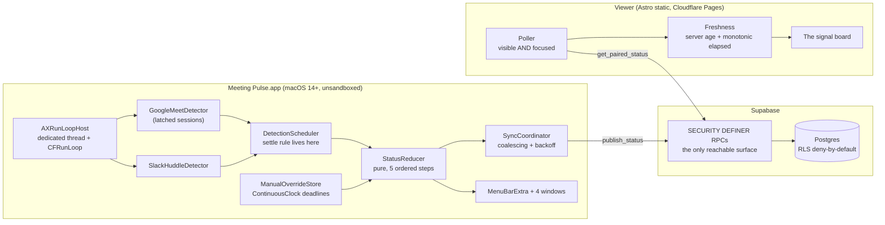

# Meeting Pulse — Implementation Plan v2.0 (final)

**Status:** Stable. Build from this document.
**Supersedes:** plan v1.0, which had 40 defects (8 blocking). All are resolved here. Traceability: `04-plan-audit-and-resolutions.md`.
**Companions:** `01-spec-audit-report.md` (why the original spec changed) · `02-meetingpulse-spec.md` (the specification) · `PRODUCT.md` (product truth) · `04-plan-audit-and-resolutions.md` (why this plan changed)

> **Storage amendment (2026-08-08).** The Keychain-based owner-secret portions
> of this plan are superseded by
> `docs/superpowers/specs/2026-08-08-no-keychain-storage-design.md`. The current
> app uses the owner-only Application Support file and one-time legacy cleanup
> described there.

> **Amendments to the specification.** This plan amends `02-meetingpulse-spec.md` v2.0 in eight places, listed in §14.1. Where this plan and the spec disagree, **this plan wins**, and §14.1 is the record of that.

---

## 0. How to use this document

### 0.1 The reading contract

You can execute this document top to bottom without asking anyone a question. Every decision that could be deferred has already been made. Where you still find a genuine gap, choose the option that **fails closed** and write the choice into `docs/decisions/` with your reasoning.

Fail closed means: never render `available` from an absence of evidence, never invent a configuration value, never swallow an Accessibility error, never report a sync that did not happen, never let a captured `unknown` decay into `inactive`.

That single rule is the product. A page that says "Free" while he is in a meeting destroys the trust that makes anyone check the page at all, and no amount of polish recovers from it. Every reducer branch, every latch transition, and every viewer freshness calculation in this plan exists to protect it.

### 0.2 Gates

Four points are gates. Do not pass one until its exit criterion is recorded in `docs/decisions/`.

| Gate | After | Blocks | Exit criterion |
|---|---|---|---|
| **G1** | Spike S1 (§6.3) | Phases 4, 6, 7, 8 | The Chrome Meet strategy is chosen empirically from the fallback ladder, with concrete selectors and a named anchor identity mechanism |
| **G2** | Spike S2 (§6.4) | Slack work in Phase 4 | A Slack huddle signal is identified, or Slack is declared manual-only |
| **G3** | Phase 2 (§5.8) | Phases 5, 6 | Every database test passes, including all fourteen negative tests |
| **G4** | Phase 5 (§9.8) | Phase 7 sign-off | The viewer passes the design contract review and the detector script reports no findings |

**Spike S1 comes before all substantial building.** It costs about half a day and it is the one assumption the product rests on: can we still observe a Meet call after the owner switches away from its tab? Building the detector, the backend, and the viewer before answering that risks discovering the product is impossible after a week of work.

### 0.3 Definition of done

A task is done when all of these hold. No exceptions, no "will fix in the next task".

1. Compiles with zero warnings under Swift 6 complete strict concurrency, or `tsc --noEmit` under `strict` with `noUncheckedIndexedAccess`.
2. The task's own tests exist and pass, including its negative tests.
3. `swift-format lint --strict`, `prettier --check`, and `eslint` pass.
4. `gitleaks detect` passes.
5. No secret, deployment value, machine-specific path, or personal identifier is committed.
6. User-visible behaviour is reflected in `README.md`, and user-visible text comes from the copy deck in §4.6, not improvised.
7. The task's stated acceptance criteria are demonstrably met, by a command someone else can run.

### 0.4 Conventions

| Thing | Value |
|---|---|
| Product name | `Meeting Pulse`, two words |
| Bundle identifier | `com.techdevix.meetingpulse` |
| Log subsystem | `com.techdevix.meetingpulse` |
| Keychain service | `com.techdevix.meetingpulse.auth` |
| Application Support | `~/Library/Application Support/MeetingPulse/` |
| Swift | Apple API Design Guidelines |
| SQL | `snake_case`, RPC parameters prefixed `p_`, internal helpers prefixed `mp_` |
| TypeScript | `camelCase` functions, `PascalCase` types, `SCREAMING_SNAKE` constants |
| Commits | Conventional Commits |
| Branches | `phase-N/short-description` |
| Time | `timestamptz` everywhere, UTC in transit, formatted only at render |
| Deadlines | `ContinuousClock` in process, wall clock only for persistence |

### 0.5 Phases

| Phase | Name | Depends on | Gate |
|---|---|---|---|
| 0 | Repository, scaffolds, tooling, local verification | — | |
| 1 | Detection spikes | 0 | **G1, G2** |
| 2 | Database: schema, RPCs, RLS | 0 | **G3** |
| 3 | Core models and the status reducer | 0 | |
| 4 | Detection: AX host, detectors, scheduler | 1, 3 | |
| 5 | Owner services: config, keychain, sync, pairing, recovery | 2, 3 | |
| 6 | Viewer web app | 2 | **G4** |
| 7 | Owner app: menu bar, windows, packaging | 4, 5 | |
| 8 | Acceptance, performance, privacy proof, release | all | |

Phases 2, 3, and 6 can run alongside the critical path. Nothing downstream of Spike S1 may start before G1.

---

## 1. Architecture at a glance



Three properties hold this together, and every later section serves one of them.

**The Mac is the only thing that knows anything.** Detection happens locally by reading window structure. Nothing about a meeting is transmitted. What crosses the network is one word, one boolean, an optional name, and two timestamps.

**The database is the clock.** Clients never assign a timestamp that matters. `publish_status` stamps `now()`, `get_paired_status` returns `now()` alongside the reading, and the viewer computes age from those two server values plus a monotonic local counter. A wrong clock on either end changes nothing.

**Uncertainty is preserved all the way through.** A detector that cannot read reports `unknown`. The scheduler does not settle it into `inactive`. The reducer does not resolve it into `available`. The viewer does not let a stale read look fresh. There is no layer where "we do not know" quietly becomes "he is free".

---

## 2. Repository layout

Files marked `*` contain placeholders only and are committed. Files marked `†` are generated and gitignored.

```text
meetingpulse/
├── README.md · CONTRIBUTING.md · SECURITY.md · LICENSE (MIT)
├── .gitignore · .gitleaks.toml · .editorconfig · .pre-commit-config.yaml
├── .xcode-version                       # "16.2"
├── PRODUCT.md                           # product truth (already written)
├── DESIGN.md †                          # written at finish, from the built world (§10.8)
│
├── docs/
│   ├── 01-spec-audit-report.md
│   ├── 02-meetingpulse-spec.md
│   ├── 03-implementation-plan.md        # this document
│   ├── 04-plan-audit-and-resolutions.md
│   ├── copy/deck.md                     # §4.6, the single source of user-facing text
│   ├── fixtures/code-normalization.json # shared by Swift, TS, and SQL
│   ├── setup/{supabase,cloudflare-pages,macos-permissions,release,operations}.md
│   └── decisions/
│       ├── 0001-meet-detection-strategy.md   # Gate G1
│       ├── 0002-slack-detection-strategy.md  # Gate G2
│       ├── 0003-pairing-throttle-layers.md   # why there is no IP layer
│       └── 0004-viewer-storage-durability.md # Safari eviction, accepted
│
├── mac-app/
│   ├── MeetingPulse.xcodeproj/
│   ├── Config.xcconfig.example *  ·  Config.xcconfig †
│   ├── ExportOptions.plist
│   ├── MeetingPulse/
│   │   ├── MeetingPulseApp.swift        # scenes: MenuBarExtra + 4 Windows
│   │   ├── Info.plist · MeetingPulse.entitlements · Assets.xcassets/
│   │   ├── Windows/{Onboarding,Pairing,Settings,Recovery}Window.swift
│   │   ├── MenuBar/{MenuBarView,MenuBarViewModel,StatusIcon}.swift
│   │   └── Resources/turnstile.html     # bundled, loaded by WKWebView
│   ├── Packages/
│   │   ├── MPCore/                      # pure logic. No Foundation beyond Date. No AppKit.
│   │   │   Sources/MPCore/{StatusModels,SourceObservation,StatusReducer,
│   │   │                   ManualOverride,DiagnosticCode,Clocks}.swift
│   │   │   Tests/MPCoreTests/{DecisionTable,Reducer,Override,Clocks}Tests.swift
│   │   ├── MPDetection/
│   │   │   Sources/MPDetection/{AXRunLoopHost,AXSnapshot,AXElementTree,AXSelectors,
│   │   │                        MeetingDetector,MeetLatch,GoogleMeetDetector,
│   │   │                        SlackHuddleDetector,DetectionScheduler,
│   │   │                        AppDiscovery,PermissionProbe,AudioCorroboration}.swift
│   │   │   Tests/MPDetectionTests/{Fixtures/,MeetLatch,GoogleMeet,Slack,Scheduler}Tests.swift
│   │   ├── MPSync/
│   │   │   Sources/MPSync/{StatusTransport,SupabaseStatusTransport,RetryPolicy,
│   │   │                   SyncCoordinator,PairingService,RecoveryService,
│   │   │                   PairingCode,TurnstileGate}.swift
│   │   │   Tests/MPSyncTests/{RetryPolicy,Coalescing,PairingCode,Normalization}Tests.swift
│   │   └── MPSupport/
│   │       Sources/MPSupport/{AppConfiguration,KeychainStore,SecretStore,
│   │                          ManualOverrideStore,DeviceProfileStore,DiagnosticsLog,
│   │                          Redactor,PermissionCoordinator,NetworkMonitor,
│   │                          LoginItem,InstallLocation,SingleInstanceLock}.swift
│   │       Tests/MPSupportTests/{Redactor,Config,OverrideStore,Keychain}Tests.swift
│   └── Tools/{axdump/,notarize.sh,gen-normalization-fixture.mjs}
│
├── viewer/
│   ├── .env.example *  ·  .env.ci *  ·  .env †
│   ├── astro.config.mjs · package.json · pnpm-lock.yaml · tsconfig.json
│   ├── eslint.config.js · .prettierrc · vitest.config.ts
│   ├── public/{favicon.svg,manifest.webmanifest,apple-touch-icon.png}
│   ├── scripts/gen-headers.mjs          # builds _headers with the real CSP host
│   └── src/
│       ├── config.ts · env.d.ts
│       ├── pages/index.astro
│       ├── layouts/Base.astro
│       ├── styles/{tokens.css,global.css,board.css}
│       ├── fonts/                       # self-hosted, subset
│       ├── ui/{Board,Signal,Pairing,Chalk,RefreshControl}.ts
│       ├── lib/{supabase,auth,pairing,status,freshness,poller,copy}.ts
│       └── test/{freshness,poller,render,pairing,normalization}.test.ts
│
├── supabase/
│   ├── config.toml
│   ├── migrations/20260809000100_initial_schema.sql
│   ├── tests/{00_helpers,01_rls_negative,02_pairing,03_throttle,04_recovery,
│   │          05_viewer_read,06_concurrency,07_normalization,08_viewer_capacity}.sql
│   └── seed/seed.sql
│
```

---

## 3. Phase 0 — Repository, scaffolds, tooling, local verification

**Goal:** a repository a stranger clones, configures from `.example` files, builds, and tests locally from the first commit, with no way to leak a secret.
**Depends on:** nothing.

Phase 0 now scaffolds the viewer and the Supabase project too. In v1 those lived in Phases 6 and 2, which meant the initial verification commands referenced directories that did not exist yet and could never pass (defect B3).

### T0.1 — Repository, licence, and the constraint that outlives everyone

`git init`. Write `LICENSE` (MIT), `README.md`, `CONTRIBUTING.md`, `SECURITY.md`.

`SECURITY.md` must carry this, in substance, because it is the constraint most likely to be violated by a well-meaning future contributor:

> Meeting Pulse's Accessibility permission is bound by macOS to the application's code-signing identity and bundle identifier. Changing the signing certificate or the bundle identifier silently revokes the grant on every existing installation. The app will look broken and the user will have no idea why. The signing identity and the bundle identifier do not change between releases without a documented migration notice.

`CONTRIBUTING.md` must state that development builds and release builds carry different signatures, so each needs its own Accessibility grant while working on the app.

**Acceptance:** `LICENSE` is MIT with the correct holder; `SECURITY.md` contains the signing constraint.

### T0.2 — Ignore rules and secret scanning

```gitignore
.DS_Store
xcuserdata/ · *.xcuserstate · DerivedData/ · build/ · *.xcarchive
mac-app/Config.xcconfig
viewer/.env
viewer/.env.local
!viewer/.env.example
!viewer/.env.ci
**/*.p12 · **/*.mobileprovision · AuthKey_*.p8 · .secrets/
node_modules/ · viewer/dist/ · viewer/.astro/
.build/ · .swiftpm/
*.log · diagnostics-*.zip · axdump-*.json · axdump-*/
DESIGN.md
```

`.gitleaks.toml` extends the defaults with the shapes this project can leak:

```toml
title = "Meeting Pulse"
[extend]
useDefault = true

[[rules]]
id = "supabase-project-url"
regex = '''https://[a-z0-9]{20}\.supabase\.co'''

[[rules]]
id = "supabase-jwt"
regex = '''eyJ[A-Za-z0-9_-]{10,}\.eyJ[A-Za-z0-9_-]{10,}\.[A-Za-z0-9_-]{10,}'''

[[rules]]
id = "meetingpulse-pairing-code"
regex = '''\b[0-9A-HJKMNP-TV-Z]{5}-[0-9A-HJKMNP-TV-Z]{5}\b'''

[[rules]]
id = "meetingpulse-recovery-phrase"
regex = '''\b([0-9A-HJKMNP-TV-Z]{5}-){5}[0-9A-HJKMNP-TV-Z]\b'''

[allowlist]
paths = ['''\.example$''', '''\.ci$''', '''docs/.*\.md$''', '''\.gitleaks\.toml$''']
```

`.pre-commit-config.yaml` runs `gitleaks`, `swift-format lint`, and `prettier --check`.

**Acceptance:** `gitleaks detect --no-git` exits 0. Writing a realistic service-role JWT into a tracked file makes it exit non-zero. Writing one into `.env.example` does **not** (the allowlist is deliberate, and T0.4 covers that file separately).

### T0.3 — Configuration templates, and the xcconfig trap

An xcconfig file treats `//` as a comment, so `https://host` truncates at the slashes. This has cost many people an afternoon. Store the scheme and host separately, then build the URL in code.

`mac-app/Config.xcconfig.example`:

```
// Copy to Config.xcconfig and fill in. Config.xcconfig is gitignored.
// Store the viewer scheme and host separately because xcconfig treats // as a comment.
// The anon key is a PUBLIC publishable key. The service_role key never goes here.
MP_SUPABASE_HOST = YOUR_PROJECT_REF.supabase.co
MP_SUPABASE_ANON_KEY = YOUR_PUBLISHABLE_ANON_KEY
MP_TURNSTILE_SITE_KEY = YOUR_TURNSTILE_SITE_KEY
MP_VIEWER_SCHEME = https
MP_VIEWER_HOSTS = meeting-pulse.example.com,og.example.com
```

`Info.plist` maps them to `MPSupabaseHost`, `MPSupabaseAnonKey`,
`MPTurnstileSiteKey`, `MPViewerScheme`, and `MPViewerHosts`.

`viewer/.env.example` (human placeholders, and building with it must **fail**):

```
PUBLIC_SUPABASE_URL=https://YOUR_PROJECT_REF.supabase.co
PUBLIC_SUPABASE_ANON_KEY=YOUR_PUBLISHABLE_ANON_KEY
PUBLIC_STATUS_ORIGINS=https://status.example.com,https://status.example.net
PUBLIC_TURNSTILE_SITE_KEY=YOUR_TURNSTILE_SITE_KEY
```

`viewer/.env.ci` (shape-valid, obviously fake, and building with it must **succeed**):

```
PUBLIC_SUPABASE_URL=https://ci000000000000000000.supabase.co
PUBLIC_SUPABASE_ANON_KEY=eyJhbGciOiJIUzI1NiIsInR5cCI6IkpXVCJ9.ci.ci
PUBLIC_STATUS_ORIGINS=https://meetingpulse-ci.pages.dev
PUBLIC_TURNSTILE_SITE_KEY=1x00000000000000000000AA
```

`1x00000000000000000000AA` is Cloudflare's documented always-passes test site key, so local verification never depends on a real Turnstile account.

**This two-file split is the fix for defect B2.** v1 copied `.env.example` and then rejected it, which made a green build impossible.

### T0.4 — Configuration loading with no fallbacks, and the failure as a test

`MPSupport/AppConfiguration.swift`:

```swift
public struct AppConfiguration: Sendable {
    public let supabaseURL: URL
    public let supabaseAnonKey: String
    public let turnstileSiteKey: String

    public enum ConfigurationError: Error, CustomStringConvertible {
        case missing(key: String)
        case placeholder(key: String)
        case malformed(key: String, expected: String)
        public var description: String { /* names Config.xcconfig.example and the key */ }
    }

    public static func load(bundle: Bundle = .main) throws -> AppConfiguration
}
```

Rules, all of which are tested:

- Empty or whitespace-only is `.missing`.
- Any value containing `YOUR_` is `.placeholder`.
- The host must match `^[a-z0-9-]{8,}\.supabase\.co$`, or be a full `https://` URL for self-hosting.
- The anon key must parse as three dot-separated base64url segments.
- **There is no default, no fallback, and no embedded project.** On failure the app shows a blocking setup window naming the exact key and file, and exits. It never runs half-configured.

`viewer/src/config.ts` mirrors this and throws at module scope, which fails `astro build`.

**Acceptance:** unit tests for missing, empty, placeholder, and malformed on both sides. A local check asserts that `cp .env.example .env && pnpm build` **fails** and that its message names `PUBLIC_SUPABASE_URL`. The bug that was defect B2 is now a regression test.

### T0.5 — Viewer scaffold (moved from Phase 6)

```bash
cd viewer
pnpm create astro@latest . -- --template minimal --typescript strict
pnpm add @supabase/supabase-js
pnpm add -D vitest jsdom @types/node prettier eslint typescript-eslint eslint-plugin-astro
```

`astro.config.mjs`: `output: "static"`, no adapter, no integrations. `tsconfig.json` extends `astro/tsconfigs/strict` and adds `noUncheckedIndexedAccess: true` and `exactOptionalPropertyTypes: true`.

Scripts: `dev`, `build`, `check` (`astro check && tsc --noEmit`), `lint`, `test`, `headers` (`node scripts/gen-headers.mjs`).

Ship a placeholder `index.astro` that renders the config values' presence and nothing else. Phase 6 replaces it. The point is that local verification has something real to build from commit one.

### T0.6 — Supabase scaffold (moved from Phase 2)

`supabase init`, commit `supabase/config.toml`, create empty `migrations/` and `tests/`. `supabase start && supabase db reset` must succeed against zero migrations.

### T0.7 — Swift packages

Four SPM packages, `swift-tools-version: 6.0`, `platforms: [.macOS(.v14)]`, `swiftSettings: [.enableUpcomingFeature("StrictConcurrency")]`, Swift Testing.

Dependency direction, which must not be violated:

```
MPCore      → nothing        (pure logic; this is what makes the reducer instant to test)
MPSupport   → MPCore
MPDetection → MPCore, MPSupport
MPSync      → MPCore, MPSupport, supabase-swift
App         → all four
```

**Acceptance:** `swift build && swift test` in each package. A local grep asserts `MPCore` imports neither `AppKit` nor `ApplicationServices`.

### T0.8 — Local verification

GitHub Actions workflows are intentionally not included. Run the checks in
`CONTRIBUTING.md` locally, including viewer checks, Swift package tests, and
secret scanning. Use `viewer/.env.ci` for a shape-valid viewer build and
`mac-app/Config.xcconfig.example` for an unsigned app-shell build.

For the database checks, run `supabase start`, `supabase db reset`, and
`supabase test db` locally.

**Acceptance:** the local checks pass from a clean clone with **no repository
secrets configured**. That is the proof the repository is contributor-safe.

---

## 4. The design contract

This section is binding. It is the brief the viewer and the owner app are built against, and Gate G4 audits the built result against it.

### 4.1 The direction

The visual world was selected by roll, from a grounded list of seven derived from the user's own scene, and confirmed by the owner. Two candidates were weighed against it and lost.

**THESIS.** A signal station publishes what one observer can see to people who cannot see it, and an empty mast is information rather than silence. This page refuses the arrangement the category always ships: a card holding a coloured dot, a name, and a timestamp.

**OWN-WORLD.** Painted marine enamel on a harbour-night ground. One vitreous plate with a hard painted rim, a hoisted day-shape as the signal, and the observation time chalked on the lower rail. Materials are flat and printed. There is no glass, no glow, no gradient.

**STORY.** She glances at her phone outside a closed door. In under a second she reads one shape and one word and knows whether to open it. When the Mac has stopped reporting she sees an empty mast, understands that nothing is being claimed, and treats it as "he might be busy" rather than as a broken page.

**FIRST VIEWPORT.** The plate fills the screen. The day-shape sits above the centre at roughly a third of the viewport height. The state word sits directly beneath it at the largest size the width allows. The chalked observation line and the refresh control sit on the lower rail, thumb-height on a phone.

**FORM.** Harbour signal station, position 6 of 7 on the grounded list, seed key `950bbeef`.

**FINISH.** Unreviewed and undocumented is unfinished. This build ends with the finish review, the verdict, and DESIGN.md.

Reproduce this contract verbatim as an HTML comment, as the first child of `<body>` in `layouts/Base.astro`, and grep the built output for `950bbeef` after the first production build. A contract the build erased is a contract nobody can audit.

### 4.2 Why an empty mast, specifically

Every other candidate had two states. A door hanger has two sides. A studio light is on or off. A shop sign says open or closed.

A signal station has three, and the third one is trained into the people who read it: when the mast is bare you do not assume fair weather, you assume you do not know. That is `unavailable`, and it is the state this product most needs to communicate without looking broken. `unavailable` is not an error message. It is a signal that is correctly, deliberately, not being made.

### 4.3 Tokens

Colour strategy is **Drenched**: the state is the colour field, edge to edge. Operate surfaces default to Restrained, and a single-datum sign earns the escalation because there is nothing else on the page to compete with.

```css
/* tokens.css — the whole palette. Nothing outside this list ships. */
:root {
  /* Ground: wet slate under a sodium lamp, at the quay, at night */
  --ground:        #0C1418;
  --ground-rail:   #070E11;

  /* The three plates. Marine enamel, not signal-light neon. */
  --plate-clear:   #10614A;   /* free */
  --plate-clear-rim:#0A4534;
  --plate-storm:   #8C2A22;   /* on a call */
  --plate-storm-rim:#5E1A14;
  --plate-bare:    #3A4247;   /* no signal: weathered zinc, deliberately dull */
  --plate-bare-rim:#272D31;

  /* Marks on the plate */
  --paint-white:   #F2EFE8;   /* painted lettering, slightly off-white */
  --chalk:         #C8CDCB;   /* the observation line */
  --pennant:       #F2EFE8;

  --focus:         #E8B23A;   /* brass */

  --step: 4px;                /* every spacing value is a multiple */
  --radius-plate: 14px;       /* craft floor: 12–16px */
  --ease-hoist: cubic-bezier(0.16, 1, 0.3, 1);
  --dur-hoist: 220ms;
}

@media (prefers-color-scheme: light) {
  :root {
    --ground: #E7E3DA;  --ground-rail: #D6D1C6;
    --plate-clear: #14785A; --plate-storm: #A8352B; --plate-bare: #8A9094;
    --chalk: #3A403E;
  }
}
```

Light mode is not a category default here. It comes from the scene: she checks this at a kitchen counter in daylight and in a dark hallway at night, so the surface follows the room.

**Type.** One family, two widths, self-hosted and subset. **Archivo Expanded 600** for the state word, **Archivo 400/500** for everything else. It is a grotesque with real signage lineage, it is not on the training-data default list, and it holds up at both monumental and small sizes.

```css
--type-state:   clamp(3.5rem, 22vw, 9rem);   /* the only fluid value on the page */
--type-lede:    1.125rem;
--type-body:    1rem;
--type-chalk:   0.875rem;
--track-state:  -0.03em;                      /* floor is -0.04em */
```

**Depth.** Elevation is declared once. The plate carries a painted rim, which is material, not a border, plus one soft shadow beneath it. No 1px border under a wide shadow.

**Motion.** One authored moment. When the state changes, the plate **repaints** as a wipe from the top rail down, 220 ms on `--ease-hoist`, as if a signal were being hoisted or struck. Nothing else on the page animates. Under `prefers-reduced-motion: reduce` the change is instantaneous and the refresh control shows a static label rather than a spinner.

**Icons.** Three authored SVG day-shapes, one consistent stroke weight, no icon library and no unicode glyphs:

- **Free:** a filled disc hoisted on a mast (the marine day-shape for a clear signal).
- **On a call:** a cone, point up (the storm cone, which historically meant a gale expected).
- **Call okay:** the cone with a small white pennant flown beneath it.
- **No signal:** a bare mast with a crosstree and nothing hoisted.

State is carried by shape and by text. Colour is confirmation, never the carrier. All four survive greyscale, every common form of colour blindness, and a 320 px screen.

### 4.4 Refused, deliberately

These are the category's defaults, and none of them ships:

Cards as page structure · a kicker or eyebrow above the heading · a coloured dot as the state indicator · gradient text · glass or blur as decoration · a coloured `border-left` on anything · sparklines or progress rings · monospace as a costume for "technical" · unicode or emoji standing in for icons · a spinner in the middle of the content · a modal for anything · section numbers · orchestrated page-load choreography · a "last updated" tooltip where a plain sentence works.

### 4.5 The owner app follows macOS, not this world

The menu bar is a native macOS surface. It uses the system font, standard menu behaviour, template images, and Apple's Human Interface Guidelines. The harbour world reaches it only in the **status icon silhouettes**, which are the same four day-shapes drawn as monochrome template images so they tint correctly in light, dark, and inverted menu bars.

An owner app that tried to be a painted enamel plate would be strangeness without purpose. The tool should disappear into the task.

### 4.6 Copy deck

Every user-facing string lives in `docs/copy/deck.md` and is imported from one module per surface (`viewer/src/lib/copy.ts`, `MPSupport/Strings.swift`). Nothing is improvised at the call site.

The reader is a non-technical person standing near a door, mildly impatient, holding a phone. She wants one word, not an education.

**The board**

| Condition | Shape | Headline | Supporting line |
|---|---|---|---|
| `busy` | cone | `{Name} is in a meeting` · or `In a meeting` with no name | `Better to wait.` |
| every other fresh, stale, offline, or unsupported result | bare mast | `Meeting status unavailable` | `Check again before you call.` |
| not paired / revoked | bare mast | `Not connected` | `Open the viewer link or enter the code he shared.` |

The neutral line avoids telling her that the owner is free when the Mac cannot
provide a trustworthy meeting signal. Everything else is one or two words.

**The chalked rail**

`Checked just now` · `Checked 40 seconds ago` · `Checked 4 minutes ago` · and after ten minutes, `Checked a while ago`. Refresh control label: `Check again`. While fetching: `Checking`.

**Pairing**

- Heading: `Enter the code`
- Lede: `Ask him for the viewer link or code. The link keeps working until he rotates it.`
- Field label: `Code`
- Button: `Connect`
- Invalid, expired, or revoked: `That code didn't work. Ask for a fresh link or code.`
- Rate limited: `Too many tries. Wait a few minutes and try again.`
- Offline during pairing: `You're offline. Connect to the internet and try again.`
- After eviction: `This device was signed out. Ask him for a new code.`

Every failure names what to do next and none of them blames her. "That code didn't work" is deliberately identical for four different server reasons, so a guessed code reveals nothing.

**Owner app: the Accessibility explanation**

> **Meeting Pulse needs to see your windows**
>
> macOS calls this Accessibility. Meeting Pulse uses it to check two things: whether Chrome has a Google Meet call open, and whether Slack has a huddle running.
>
> It does not read page contents, meeting names, links, or anything you type. It never asks for screen recording, and it never touches your screen, microphone, or camera.
>
> Three things leave this Mac: one word (free, on a call, or no signal), whether calls are okay right now, and the name you choose to show.
>
> `Open Accessibility settings`

**Owner app: menu items**

`Set busy…` · `Set available…` · `Clear override` · `Calls are okay` · `Check and publish now` · `Display name…` · `Create viewer link…` · `Rotate viewer link…` · `Revoke viewer access…` · `Show recovery phrase…` · `Diagnostics…` · `Delete everything…` · `Quit Meeting Pulse`

**Owner app: recovery phrase**

> **Save this phrase**
>
> If this Mac is wiped or replaced, this phrase is the only way to keep your connection without asking her to pair again. Anyone who has it can take over publishing your status, so store it where you keep passwords.
>
> `I've saved it`

**Owner app: delete confirmation**

> **Delete everything?**
>
> This removes your status, your pairing codes, and her connection from the server. She'll see "Not connected" and will need a new code. This can't be undone.
>
> Type `delete` to confirm.

---

## 5. Phase 2 — Database  ⛔ Gate G3

**Goal:** a database where the only reachable operations are twelve RPCs, each of which verifies ownership, validates every field, and assigns its own timestamps.
**Depends on:** Phase 0. **Blocks:** Phases 5 and 6.

### 5.1 Project setup

1. Create the Supabase project in the region nearest the owner.
2. Auth ▸ Providers ▸ **enable Anonymous sign-ins**.
3. Auth ▸ Bot and Abuse Protection ▸ **enable Turnstile**, with the Cloudflare secret key. Record the site key for both clients.
4. Note the anon key and project URL into local config only. **The service-role key never leaves the operator's secret store**, and it is not needed by either client.
5. Record everything in `docs/setup/supabase.md`, written so it survives dashboard redesigns.

### 5.2 Migration 1 — extensions and default privileges

```sql
create extension if not exists pgcrypto with schema extensions;

-- Defect M8: PostgreSQL grants EXECUTE on new functions to PUBLIC by default.
-- Fixing that only in the last migration leaves every intermediate state exposed.
alter default privileges in schema public revoke execute on functions from public;
```

### 5.3 Migration 2 — tables

```sql
-- ============================================================================
-- devices
--
-- owner_user_id is NULLABLE with ON DELETE SET NULL, not CASCADE (defect B6).
-- Anonymous auth rows are ephemeral. Cascading from them would delete the
-- device, its status, its codes, and every viewer pairing at exactly the moment
-- rebind_device exists to recover from. The recovery hash is the durable
-- authority; the auth row is a lease.
-- ============================================================================
create table public.devices (
  id             uuid primary key default gen_random_uuid(),
  owner_user_id  uuid references auth.users(id) on delete set null,
  display_name   text,
  recovery_hash  text not null,
  instance_nonce uuid not null default gen_random_uuid(),
  created_at     timestamptz not null default now(),
  revoked_at     timestamptz,
  constraint devices_display_name_len
    check (display_name is null or char_length(display_name) <= 80),
  constraint devices_recovery_hash_shape
    check (recovery_hash ~ '^[0-9a-f]{64}$')
);

create unique index devices_one_active_per_owner
  on public.devices(owner_user_id)
  where revoked_at is null and owner_user_id is not null;

create unique index devices_recovery_hash_key on public.devices(recovery_hash);

-- ============================================================================
-- current_status: exactly one row per device
-- ============================================================================
create table public.current_status (
  device_id           uuid primary key references public.devices(id) on delete cascade,
  state               text not null check (state in ('available','busy','unavailable')),
  call_okay           boolean not null default false,
  screen_sharing      text check (screen_sharing in ('yes','no','unavailable')),
  override_mode       text check (override_mode in ('busy','available')),
  override_expires_at timestamptz,
  last_seen_at        timestamptz not null default now(),
  updated_at          timestamptz not null default now(),
  schema_version      integer not null default 1
);

-- ============================================================================
-- pairing_codes: hashed, ten minutes, single use
-- ============================================================================
create table public.pairing_codes (
  id         uuid primary key default gen_random_uuid(),
  device_id  uuid not null references public.devices(id) on delete cascade,
  code_hash  text not null unique,
  expires_at timestamptz not null,
  claimed_at timestamptz,
  revoked_at timestamptz,
  created_at timestamptz not null default now(),
  constraint pairing_codes_hash_shape check (code_hash ~ '^[0-9a-f]{64}$')
);

create index pairing_codes_device_idx on public.pairing_codes(device_id);
create index pairing_codes_live_idx on public.pairing_codes(expires_at)
  where claimed_at is null and revoked_at is null;

-- ============================================================================
-- viewers
-- ============================================================================
create table public.viewers (
  device_id      uuid not null references public.devices(id) on delete cascade,
  viewer_user_id uuid not null references auth.users(id) on delete cascade,
  created_at     timestamptz not null default now(),
  revoked_at     timestamptz,
  primary key (device_id, viewer_user_id)
);

-- Defect M5: a viewer identity holds at most ONE active pairing, so
-- get_paired_status is deterministic by construction rather than by ORDER BY.
create unique index viewers_one_active_per_viewer
  on public.viewers(viewer_user_id) where revoked_at is null;

-- The lookup direction the viewer read actually uses.
create index viewers_viewer_idx on public.viewers(viewer_user_id) where revoked_at is null;

-- ============================================================================
-- Throttle tables. No client grant, ever.
--
-- There is no per-IP table (defect M1). Behind Supabase's connection pooler,
-- inet_client_addr() returns the pooler's address, so a per-IP limit would
-- either lump every viewer together and lock them all out after 20 attempts,
-- or separate nothing at all. Anti-abuse is Turnstile, the per-user limit,
-- and the global breaker. Recorded in docs/decisions/0003.
-- ============================================================================
create table public.pairing_attempts (
  user_id           uuid primary key references auth.users(id) on delete cascade,
  window_started_at timestamptz not null default now(),
  attempt_count     integer not null default 0
);

create table public.pairing_attempts_global (
  id                boolean primary key default true check (id),
  window_started_at timestamptz not null default now(),
  failure_count     integer not null default 0
);

insert into public.pairing_attempts_global (id) values (true) on conflict do nothing;
```

### 5.4 Migration 3 — RLS

```sql
alter table public.devices                 enable row level security;
alter table public.current_status          enable row level security;
alter table public.pairing_codes           enable row level security;
alter table public.viewers                 enable row level security;
alter table public.pairing_attempts        enable row level security;
alter table public.pairing_attempts_global enable row level security;

-- Defect M2: FORCE ROW LEVEL SECURITY is deliberately NOT used.
-- FORCE applies RLS to the table owner too, so every SECURITY DEFINER function
-- would then depend on its definer role holding BYPASSRLS. That is an ambient
-- property of a hosted role, invisible in the schema, and silently breakable.
-- Enabled-but-not-forced plus zero write policies gives the same guarantee
-- without the hidden dependency. Test 01 asserts the definer's bypass status
-- explicitly so the assumption is checked rather than assumed.

-- The only two direct SELECT policies in the schema. Both are owner-scoped.
create policy devices_owner_select on public.devices
  for select to authenticated
  using (owner_user_id = (select auth.uid()));

create policy current_status_owner_select on public.current_status
  for select to authenticated
  using (exists (
    select 1 from public.devices d
    where d.id = current_status.device_id
      and d.owner_user_id = (select auth.uid())
  ));

-- Deliberately absent, and asserted absent by test 01:
--   * any INSERT, UPDATE, or DELETE policy on any table
--   * any viewer-facing SELECT policy (viewers read only via get_paired_status)
--   * any policy at all on pairing_codes or the two throttle tables
```

The viewer gets no table grant because a row policy would hand it `override_mode` and `override_expires_at`, which reveal that he set the state by hand. Routing the read through a function also lets it return `server_now` from the same statement and withhold the device id. One mechanism, three problems.

### 5.5 Migration 4 — owner RPCs

```sql
create or replace function public.mp_current_device_id()
returns uuid language sql stable security definer
set search_path = public, pg_temp as $$
  select id from public.devices
  where owner_user_id = (select auth.uid()) and revoked_at is null
  limit 1;
$$;
revoke execute on function public.mp_current_device_id() from public;

-- ---------------------------------------------------------------------------
-- register_device
-- Defect M3: idempotent under concurrency via an advisory lock keyed on the
-- owner. Without it, two launches race, both see no device, and one gets a
-- unique-index violation instead of the existing id it was promised.
-- ---------------------------------------------------------------------------
create or replace function public.register_device(p_recovery_hash text)
returns jsonb language plpgsql security definer
set search_path = public, pg_temp as $$
declare
  v_uid uuid := (select auth.uid());
  v_id  uuid;
  v_nonce uuid;
begin
  if v_uid is null then raise exception 'unauthenticated' using errcode='28000'; end if;
  if p_recovery_hash !~ '^[0-9a-f]{64}$' then
    raise exception 'invalid_recovery_hash' using errcode='22023';
  end if;

  perform pg_advisory_xact_lock(hashtextextended(v_uid::text, 0));

  select id, instance_nonce into v_id, v_nonce
    from public.devices where owner_user_id = v_uid and revoked_at is null;

  if v_id is null then
    insert into public.devices (owner_user_id, recovery_hash)
    values (v_uid, p_recovery_hash)
    returning id, instance_nonce into v_id, v_nonce;

    insert into public.current_status (device_id, state, call_okay)
    values (v_id, 'unavailable', false);
  end if;

  return jsonb_build_object('device_id', v_id, 'instance_nonce', v_nonce);
end;
$$;
revoke execute on function public.register_device(text) from public;
grant  execute on function public.register_device(text) to authenticated;

-- ---------------------------------------------------------------------------
-- publish_status: the only path by which status is ever written.
--
-- p_instance_nonce (defect M30) lets a superseded Mac find out it lost
-- ownership. If a second Mac rebinds the device, the nonce rotates and the old
-- Mac's next publish returns superseded=true, at which point it stops
-- publishing and tells its owner instead of fighting for the row.
-- ---------------------------------------------------------------------------
create or replace function public.publish_status(
  p_state               text,
  p_call_okay           boolean,
  p_instance_nonce      uuid,
  p_override_mode       text default null,
  p_override_expires_at timestamptz default null,
  p_screen_sharing      text default null
) returns jsonb language plpgsql security definer
set search_path = public, pg_temp as $$
declare
  v_device uuid := public.mp_current_device_id();
  v_nonce  uuid;
  v_now    timestamptz := now();
begin
  if v_device is null then raise exception 'no_device' using errcode='42704'; end if;
  if p_state not in ('available','busy','unavailable') then
    raise exception 'invalid_state' using errcode='22023';
  end if;
  if p_override_mode is not null and p_override_mode not in ('busy','available') then
    raise exception 'invalid_override_mode' using errcode='22023';
  end if;
  if p_screen_sharing is not null and p_screen_sharing not in ('yes','no','unavailable') then
    raise exception 'invalid_screen_sharing' using errcode='22023';
  end if;

  select instance_nonce into v_nonce from public.devices where id = v_device;
  if v_nonce is distinct from p_instance_nonce then
    return jsonb_build_object('superseded', true, 'last_seen_at', null);
  end if;

  insert into public.current_status as cs (
    device_id, state, call_okay, screen_sharing,
    override_mode, override_expires_at, last_seen_at, updated_at, schema_version)
  values (v_device, p_state, coalesce(p_call_okay,false), p_screen_sharing,
          p_override_mode, p_override_expires_at, v_now, v_now, 1)
  on conflict (device_id) do update set
    state = excluded.state,
    call_okay = excluded.call_okay,
    screen_sharing = excluded.screen_sharing,
    override_mode = excluded.override_mode,
    override_expires_at = excluded.override_expires_at,
    last_seen_at = v_now,
    updated_at = v_now;

  return jsonb_build_object('superseded', false, 'last_seen_at', v_now);
end;
$$;
revoke execute on function public.publish_status(text,boolean,uuid,text,timestamptz,text) from public;
grant  execute on function public.publish_status(text,boolean,uuid,text,timestamptz,text) to authenticated;

-- ---------------------------------------------------------------------------
-- update_device_profile: display name only. No general column mutation exists.
-- ---------------------------------------------------------------------------
create or replace function public.update_device_profile(p_display_name text)
returns void language plpgsql security definer
set search_path = public, pg_temp as $$
declare
  v_device uuid := public.mp_current_device_id();
  v_name   text;
begin
  if v_device is null then raise exception 'no_device' using errcode='42704'; end if;
  v_name := btrim(coalesce(p_display_name, ''));
  v_name := regexp_replace(v_name, '[\u0000-\u001F\u007F]', '', 'g');
  if char_length(v_name) > 80 then
    raise exception 'display_name_too_long' using errcode='22023';
  end if;
  if v_name = '' then v_name := null; end if;
  update public.devices set display_name = v_name where id = v_device;
end;
$$;
revoke execute on function public.update_device_profile(text) from public;
grant  execute on function public.update_device_profile(text) to authenticated;

-- ---------------------------------------------------------------------------
-- create_pairing_code
-- Defect M7: the TTL parameter is gone. It let a modified client mint
-- one-hour codes while the security argument assumed ten minutes.
-- ---------------------------------------------------------------------------
create or replace function public.create_pairing_code(p_code_hash text)
returns uuid language plpgsql security definer
set search_path = public, pg_temp as $$
declare
  v_device uuid := public.mp_current_device_id();
  v_id     uuid;
begin
  if v_device is null then raise exception 'no_device' using errcode='42704'; end if;
  if p_code_hash !~ '^[0-9a-f]{64}$' then
    raise exception 'invalid_code_hash' using errcode='22023';
  end if;

  update public.pairing_codes set revoked_at = now()
   where device_id = v_device and claimed_at is null and revoked_at is null;

  insert into public.pairing_codes (device_id, code_hash, expires_at)
  values (v_device, p_code_hash, now() + interval '10 minutes')
  returning id into v_id;
  return v_id;
end;
$$;
revoke execute on function public.create_pairing_code(text) from public;
grant  execute on function public.create_pairing_code(text) to authenticated;

-- rotate_pairing_codes / revoke_viewer / revoke_all_viewers / list_viewers
-- follow the same shape: resolve mp_current_device_id(), raise no_device when
-- null, act only within that device, revoke execute from public, grant to
-- authenticated. Written out in full in supabase/migrations.

-- ---------------------------------------------------------------------------
-- delete_device
-- Defect M6: this deletes the device graph and the caller's throttle row.
-- It does NOT delete the anonymous auth.users row, which needs the Auth Admin
-- API and therefore an operator action. The UI copy says what actually happens
-- and docs/setup/operations.md carries the manual step.
-- ---------------------------------------------------------------------------
create or replace function public.delete_device()
returns void language plpgsql security definer
set search_path = public, pg_temp as $$
declare
  v_uid uuid := (select auth.uid());
  v_device uuid := public.mp_current_device_id();
begin
  if v_device is not null then
    delete from public.devices where id = v_device;   -- cascades
  end if;
  delete from public.pairing_attempts where user_id = v_uid;
end;
$$;
revoke execute on function public.delete_device() from public;
grant  execute on function public.delete_device() to authenticated;
```

### 5.6 Migration 5 — pairing, throttling, recovery

```sql
-- ---------------------------------------------------------------------------
-- Normalization. Defect M12: the canonical order is
--     UPPERCASE  →  MAP CONFUSABLES  →  STRIP
-- and it is stated once, here, because v1's prose said "upper, strip, map",
-- which deletes I, L, and O instead of mapping them. Swift and TypeScript
-- implement this exact order and all three are pinned to one fixture.
-- ---------------------------------------------------------------------------
create or replace function public.mp_normalize_code(p_code text)
returns text language sql immutable as $$
  select regexp_replace(
           translate(upper(coalesce(p_code,'')), 'ILOU', '1101'),
           '[^0-9A-HJKMNP-TV-Z]', '', 'g');
$$;

create or replace function public.mp_hash_code(p_code text)
returns text language sql immutable
set search_path = public, extensions, pg_temp as $$
  select encode(extensions.digest(public.mp_normalize_code(p_code), 'sha256'), 'hex');
$$;
revoke execute on function public.mp_normalize_code(text) from public;
revoke execute on function public.mp_hash_code(text) from public;

-- ---------------------------------------------------------------------------
-- Throttle: two layers, not three.
--   L1 per authenticated user, 5 per fixed 15-minute tumbling window
--   L2 global circuit breaker, 100 failures per hour
-- The global layer is the one an attacker minting fresh anonymous users cannot
-- dodge, and Turnstile is what makes minting them expensive in the first place.
-- ---------------------------------------------------------------------------
create or replace function public.mp_throttle_check()
returns boolean language plpgsql security definer
set search_path = public, pg_temp as $$
declare
  v_uid uuid := (select auth.uid());
  v_now timestamptz := now();
  v_count integer; v_win timestamptz;
begin
  -- Global first: it is the layer that cannot be dodged, and checking it first
  -- also fixes the lock ordering (global before per-user, always) so two
  -- concurrent claims cannot deadlock against each other.
  select failure_count, window_started_at into v_count, v_win
    from public.pairing_attempts_global where id = true for update;
  if v_now - v_win >= interval '1 hour' then
    update public.pairing_attempts_global
       set window_started_at = v_now, failure_count = 0 where id = true;
  elsif v_count >= 100 then
    return false;
  end if;

  insert into public.pairing_attempts (user_id, window_started_at, attempt_count)
  values (v_uid, v_now, 0) on conflict (user_id) do nothing;

  select attempt_count, window_started_at into v_count, v_win
    from public.pairing_attempts where user_id = v_uid for update;

  if v_now - v_win >= interval '15 minutes' then
    update public.pairing_attempts
       set window_started_at = v_now, attempt_count = 1 where user_id = v_uid;
  elsif v_count >= 5 then
    return false;
  else
    update public.pairing_attempts
       set attempt_count = attempt_count + 1 where user_id = v_uid;
  end if;

  return true;
end;
$$;
revoke execute on function public.mp_throttle_check() from public;

create or replace function public.mp_record_failure()
returns void language sql security definer set search_path = public, pg_temp as $$
  update public.pairing_attempts_global set failure_count = failure_count + 1 where id = true;
$$;
revoke execute on function public.mp_record_failure() from public;

-- ---------------------------------------------------------------------------
-- claim_pairing_code
--
-- Defect B4: the claim is ONE atomic statement. v1 selected, checked, then
-- updated, so two viewers could both observe an unclaimed code and both pair.
--
-- Defect M5: claiming revokes any prior active pairing for this viewer in the
-- same transaction, which keeps the one-active-pairing index satisfiable and
-- makes get_paired_status deterministic.
--
-- Response shape is identical for invalid, expired, claimed, and revoked, so a
-- guessed code reveals nothing about whether it belongs to someone. This is
-- response-shape suppression, not timing indistinguishability (defect M9);
-- at 50 bits with a 10-minute window and a global breaker, timing is not the
-- weak link and the plan does not pretend otherwise.
-- ---------------------------------------------------------------------------
create or replace function public.claim_pairing_code(p_code text)
returns jsonb language plpgsql security definer
set search_path = public, pg_temp as $$
declare
  v_uid    uuid := (select auth.uid());
  v_device uuid;
begin
  if v_uid is null then raise exception 'unauthenticated' using errcode='28000'; end if;

  if not public.mp_throttle_check() then
    return jsonb_build_object('ok', false, 'reason', 'rate_limited');
  end if;

  if char_length(public.mp_normalize_code(p_code)) <> 10 then
    perform public.mp_record_failure();
    return jsonb_build_object('ok', false, 'reason', 'invalid_code');
  end if;

  update public.pairing_codes
     set claimed_at = now()
   where code_hash  = public.mp_hash_code(p_code)
     and claimed_at is null
     and revoked_at is null
     and expires_at > now()
  returning device_id into v_device;

  if v_device is null then
    perform public.mp_record_failure();
    return jsonb_build_object('ok', false, 'reason', 'invalid_code');
  end if;

  update public.viewers set revoked_at = now()
   where viewer_user_id = v_uid and revoked_at is null and device_id <> v_device;

  insert into public.viewers (device_id, viewer_user_id)
  values (v_device, v_uid)
  on conflict (device_id, viewer_user_id) do update set revoked_at = null;

  -- Deliberately returns no device_id.
  return jsonb_build_object('ok', true);
end;
$$;
revoke execute on function public.claim_pairing_code(text) from public;
grant  execute on function public.claim_pairing_code(text) to authenticated;

-- ---------------------------------------------------------------------------
-- rebind_device
--
-- Defect M4: the target is locked before it is read, so two identities cannot
-- both succeed. And it no longer deletes every other device the caller owns.
-- It reclaims only a genuinely empty one (no viewers, never published) and
-- otherwise raises rebind_would_orphan rather than destroying data the caller
-- did not knowingly agree to lose.
--
-- Rotating instance_nonce is what tells the previous Mac it has been
-- superseded, on its very next publish.
-- ---------------------------------------------------------------------------
create or replace function public.rebind_device(p_recovery_secret text)
returns jsonb language plpgsql security definer
set search_path = public, pg_temp as $$
declare
  v_uid uuid := (select auth.uid());
  v_id uuid; v_nonce uuid; v_existing uuid; v_viewers int; v_published int;
begin
  if v_uid is null then raise exception 'unauthenticated' using errcode='28000'; end if;
  if not public.mp_throttle_check() then
    raise exception 'rate_limited' using errcode='53400';
  end if;

  select id into v_id from public.devices
   where recovery_hash = public.mp_hash_code(p_recovery_secret)
     and revoked_at is null
   for update;

  if v_id is null then
    perform public.mp_record_failure();
    raise exception 'invalid_recovery_secret' using errcode='22023';
  end if;

  select id into v_existing from public.devices
   where owner_user_id = v_uid and revoked_at is null and id <> v_id for update;

  if v_existing is not null then
    select count(*) into v_viewers from public.viewers
     where device_id = v_existing and revoked_at is null;
    select count(*) into v_published from public.current_status
     where device_id = v_existing and state <> 'unavailable';
    if v_viewers > 0 or v_published > 0 then
      raise exception 'rebind_would_orphan' using errcode='23505';
    end if;
    delete from public.devices where id = v_existing;
  end if;

  update public.devices
     set owner_user_id = v_uid, instance_nonce = gen_random_uuid()
   where id = v_id
  returning instance_nonce into v_nonce;

  return jsonb_build_object('device_id', v_id, 'instance_nonce', v_nonce);
end;
$$;
revoke execute on function public.rebind_device(text) from public;
grant  execute on function public.rebind_device(text) to authenticated;
```

### 5.7 Migration 6 — the viewer read

```sql
-- ---------------------------------------------------------------------------
-- get_paired_status: the only read a viewer can perform.
--
-- VOLATILE, not STABLE. A STABLE function uses the snapshot time of the calling
-- statement, which is the same thing here, but marking it volatile removes any
-- question about now() and keeps the planner from caching across a call.
--
-- Returns server_now from the same statement as last_seen_at so the client can
-- compute age without ever consulting its own clock.
-- Omits device_id, override_mode, override_expires_at.
-- ---------------------------------------------------------------------------
create or replace function public.get_paired_status()
returns jsonb language plpgsql security definer
set search_path = public, pg_temp as $$
declare
  v_uid uuid := (select auth.uid());
  v_res jsonb;
begin
  if v_uid is null then raise exception 'unauthenticated' using errcode='28000'; end if;

  select jsonb_build_object(
           'paired', true,
           'display_name', d.display_name,
           'state', cs.state,
           'call_okay', cs.call_okay,
           'last_seen_at', cs.last_seen_at,
           'server_now', now(),
           'schema_version', cs.schema_version)
    into v_res
    from public.viewers v
    join public.devices d         on d.id = v.device_id
    join public.current_status cs on cs.device_id = d.id
   where v.viewer_user_id = v_uid
     and v.revoked_at is null
     and d.revoked_at is null
   order by v.created_at desc
   limit 1;

  return coalesce(v_res, jsonb_build_object('paired', false, 'server_now', now()));
end;
$$;
revoke execute on function public.get_paired_status() from public;
grant  execute on function public.get_paired_status() to authenticated;
```

Migration 7 repeats every `revoke`/`grant` idempotently as a belt-and-braces final state, and revokes all table privileges from `anon`. The `anon` role, which is what a client holds before signing in, can do nothing whatsoever.

### 5.8 Database tests  ⛔ **Gate G3**

pgTAP, run by `supabase test db`. Every file is wrapped in `BEGIN` / `ROLLBACK`, because `SET LOCAL` outside a transaction does not reliably apply JWT claims and v1's `supabase db execute` loop was not the CLI's test workflow (defect M10).

`00_helpers.sql` provides the harness, and it must exist before any other test:

```sql
create or replace function tests.create_user() returns uuid as $$
  insert into auth.users (id, aud, role, instance_id)
  values (gen_random_uuid(), 'authenticated', 'authenticated',
          '00000000-0000-0000-0000-000000000000')
  returning id;
$$ language sql;

create or replace function tests.become(p_uid uuid) returns void as $$
begin
  perform set_config('role', 'authenticated', true);
  perform set_config('request.jwt.claims',
    json_build_object('sub', p_uid, 'role', 'authenticated')::text, true);
end; $$ language plpgsql;

create or replace function tests.become_anon() returns void as $$
begin
  perform set_config('role', 'anon', true);
  perform set_config('request.jwt.claims', '', true);
end; $$ language plpgsql;
```

**`01_rls_negative.sql` — fourteen tests that must all FAIL to do the thing.** These matter more than every positive test combined.

| # | Attempt | Expected |
|---|---|---|
| 1 | Viewer selects `current_status` | 0 rows |
| 2 | Viewer selects `devices` | 0 rows |
| 3 | Viewer updates `current_status` | denied or 0 rows |
| 4 | Owner A selects Owner B's device | 0 rows |
| 5 | Any client selects `pairing_codes` | 0 rows |
| 6 | Any client selects `pairing_attempts_global` | permission denied |
| 7 | Any client executes `mp_throttle_check()` | permission denied |
| 8 | Any client executes `mp_hash_code()` | permission denied |
| 9 | Owner inserts into `current_status` directly | permission denied |
| 10 | `anon` role executes `get_paired_status()` | permission denied |
| 11 | `register_device` called twice | same uuid, no error |
| 12 | Forced second active device row for one owner | unique violation |
| 13 | Second active pairing for one viewer | unique violation |
| 14 | The definer role of `publish_status` has `rolbypassrls` | true |

Test 14 is the explicit check of the assumption that replaced `FORCE ROW LEVEL SECURITY` (defect M2). If it ever fails, the security model changed underneath us and we find out in local verification rather than in production.

**`02_pairing.sql`.** Create, claim, then: claim again, claim an expired code, claim a revoked code, claim garbage. Assert all four failure payloads are **byte-identical**. Assert the raw code appears in no column of any table.

**`03_throttle.sql`.** Five failures then a sixth returns `rate_limited`. Advance `window_started_at` by 16 minutes and it is allowed again. Drive the global counter to 100 and assert a **brand-new user** is also rate limited, which is the test proving the anonymous-minting bypass is closed (defect M11: this test is now reachable because the IP layer that used to block first is gone).

**`04_recovery.sql`.** Register, pair a viewer, switch to a new `auth.uid()`, `rebind_device(secret)`. Assert the same device id, the **viewer pairing still resolves**, and `instance_nonce` changed. Then: wrong secret raises and increments the global counter; a caller who already owns a device with viewers gets `rebind_would_orphan`; a caller owning an empty device succeeds.

**`05_viewer_read.sql`.** `get_paired_status()` returns exactly the seven documented keys. Assert `override_mode`, `override_expires_at`, and `device_id` are **absent from the JSON**. Assert `server_now >= last_seen_at`. A revoked viewer gets `{paired:false}`.

**`06_concurrency.sql`.** Using `dblink` or two `pg_background` sessions: two simultaneous claims of one code produce exactly one success. Two simultaneous `register_device` calls for one owner return the same uuid. Two simultaneous `rebind_device` calls for one secret produce exactly one winner.

**`07_normalization.sql`.** Runs the generated `VALUES` fixture (§7.3) through `mp_normalize_code` and `mp_hash_code` and asserts every row matches, plus a checksum over the fixture that Swift and TypeScript assert too.

**Gate G3 exit criterion:** every test above passes locally. Phases 5 and 6 do not begin before that.

---

## 6. Phase 1 — Detection spikes  ⛔ Gates G1, G2

**Goal:** replace the product's largest assumption with a measurement.
**Depends on:** Phase 0. **Blocks:** Phase 4 and everything downstream.

### 6.1 The `axdump` tool

A Swift command-line tool at `mac-app/Tools/axdump`. Development only, never shipped.

```
axdump --bundle com.google.Chrome --depth 14 --out dumps/meet-active-fg.json
axdump --watch --bundle com.google.Chrome      # streams AX notifications with timestamps
axdump --diff dumps/a.json dumps/b.json        # what changed between two states
```

Per element it records `AXRole`, `AXSubrole`, `AXRoleDescription`, `AXIdentifier`, `AXTitle`, `AXDescription`, `AXValue` (truncated to 120 characters), `AXHelp`, `AXEnabled`, `AXFocused`, child count, the path from the root, and the window number from `_AXUIElementGetWindow` where available.

`--diff` is what turns a pile of trees into an answer. The question "which elements exist during a call and not before it" is tedious by eye and instant by diff.

**Acceptance:** produces a tree for a running app; exits with a clear message when Accessibility is not granted rather than emitting an empty tree; `--diff` reports added and removed paths.

### 6.2 Fixture sanitisation

Fixtures get committed and the repository is public, so this needs care. v1 hashed every label to eight hex characters, which is both dictionary-reversible for common strings and destroys the very labels the selectors need to match (defect M28).

The rule instead:

- **Structural attributes are preserved verbatim.** `AXRole`, `AXSubrole`, `AXIdentifier`, and role descriptions are not sensitive and are exactly what the selectors match on.
- **Human content is replaced with a reviewed pseudonym.** Meeting titles, participant names, URLs, and channel names become stable tokens like `<title:1>`, `<person:2>`, `<url:1>`, recorded in a per-fixture `mapping.json` that is **not** committed.
- **A human reads every fixture before it is committed.** No automation is trusted with this.
- A test asserts no fixture contains an `@` sign, a `meet.google.com` string, or an `https://` URL.

### 6.3 Spike S1 — Chrome and Google Meet  ⛔ **Gate G1**

Capture each scenario, then answer the questions.

| # | Scenario | Capture |
|---|---|---|
| 1 | Chrome open, no Meet tab | `baseline` |
| 2 | Meet landing page, not in a call | `meet-landing` |
| 3 | Pre-join / lobby screen | `meet-prejoin` |
| 4 | In a call, Meet tab foreground | `meet-active-fg` |
| 5 | **In a call, switched to another tab in the same window** | `meet-active-bgtab` |
| 6 | **In a call, switched to a different app** | `meet-active-appbg` |
| 7 | **In a call, Chrome window minimised** | `meet-active-min` |
| 8 | In a call, a second Chrome window in front | `meet-active-2win` |
| 9 | Just left the call | `meet-left` |
| 10 | Meet tab closed, Chrome still open | `meet-closed` |
| 11 | Meet in a second Chrome profile window | `meet-profile2` |
| 12 | Meet as an installed PWA window | `meet-pwa` |
| 13 | **Two Meet calls in two windows at once** | `meet-two-calls` |

**Questions, each answered with evidence:**

- **Q1** In captures 5, 6, and 7, does a Meet `AXWebArea` still exist anywhere in Chrome's tree?
- **Q2** In those captures, does the tab strip expose a per-tab element (usually `AXRadioButton` under an `AXTabGroup`) that identifies the Meet tab?
- **Q3** Does capture 10 differ observably from capture 5? Can "tab closed" be told apart from "tab backgrounded"?
- **Q4** Which elements in capture 4 are absent from captures 2, 3, and 9? Those are the in-call confirmation signals. Prefer stable `AXIdentifier` values, then role and subrole shapes, and treat localized `AXTitle` strings as least reliable and never sufficient alone.
- **Q5** Which AX notifications fire on call start and end, and with what latency?
- **Q6** **What is the stable anchor identity?** (defect M18) Is `_AXUIElementGetWindow` available and stable across traversals? Does the tab element survive reordering? Record exactly what the latch will key on and what invalidates it.
- **Q7** Does the PWA window resolve under `com.google.Chrome` or a separate bundle identifier (defect M17)?

**The fallback ladder, in order:**

1. **Q1 yes.** The direct algorithm suffices; the latch becomes a robustness bonus.
2. **Q1 no, Q2 yes.** The latched model ships as designed. This is the expected outcome.
3. **Q1 no, Q2 no, Q3 yes.** Latch on window-level liveness only, `maxLatchDuration` drops to 2 hours, accuracy is reduced, and the README says so plainly.
4. **All no.** **Google Meet auto-detection is cut.** Meet becomes manual-only, Slack ships alone, the README states the limitation, and spec §3.1 goal 1 is amended. Do not ship a detector that guesses.

**Gate G1 exit criterion:** `docs/decisions/0001-meet-detection-strategy.md` exists, names a ladder rung, lists concrete selector predicates for confirmation and for liveness, names the anchor identity mechanism from Q6, and states PWA support from Q7.

### 6.4 Spike S2 — Slack Huddles  ⛔ **Gate G2**

| # | Scenario | Capture |
|---|---|---|
| 1 | Slack open, no huddle | `slack-idle` |
| 2 | Huddle active, Slack focused | `slack-huddle-fg` |
| 3 | **Huddle active, Slack unfocused** | `slack-huddle-bg` |
| 4 | Huddle active, Slack minimised | `slack-huddle-min` |
| 5 | Huddle active with the mini-window visible | `slack-huddle-window` |
| 6 | Huddle just ended | `slack-huddle-end` |
| 7 | Slack quit | `slack-absent` |

**Check the separate huddle window first.** A dedicated `AXWindow` is far more observable than Electron document content and, crucially, it survives backgrounding, which is exactly the property the Chrome case lacks. If it is there, Slack is the easy detector and Chrome is the hard one.

**Questions:** Is there a distinct huddle `AXWindow`, and does it persist through captures 3 and 4? If not, is there a stable in-window element with a usable `AXIdentifier`? Does Slack require `AXManualAccessibility` to be set on the app element before Electron exposes a full tree? (Electron apps commonly do. If so the detector sets it once per attach and the side effect is documented.) Which notifications fire on huddle start and end?

**Gate G2 exit criterion:** `docs/decisions/0002-slack-detection-strategy.md` names a signal, or declares Slack manual-only and amends spec §3.1 goal 2 and the README.

### 6.5 Commit the fixtures

Convert the sanitised dumps into `MPDetectionTests/Fixtures/`. This corpus is what lets the detector be developed and regression-tested without joining a real meeting for every run.

---

## 7. Phase 3 — Core models, reducer, override, and shared primitives

**Goal:** the part of the system that must be provably correct, with no I/O, no AppKit, no network, and no clock of its own.
**Depends on:** Phase 0. Runs alongside Phase 2.

### 7.1 Clocks

Two clocks, and using the wrong one is defect M25.

```swift
/// Wall clock. For timestamps that get persisted or displayed. Can jump.
public protocol WallClock: Sendable { var now: Date { get } }

/// Monotonic. For every deadline. Cannot jump, cannot go backwards.
/// ContinuousClock keeps counting across system sleep, which is what an
/// override expiry needs: "30 minutes from now" must mean 30 minutes even if
/// the Mac slept for 20 of them.
public protocol Monotonic: Sendable {
    func now() -> ContinuousClock.Instant
    func sleep(until: ContinuousClock.Instant) async throws
}
```

Nothing in `MPCore` calls `Date()` or `ContinuousClock()` directly. Everything takes an injected clock, which is what makes expiry tests deterministic rather than slow and flaky.

**Rule:** if a value is compared to decide whether something has expired, it is monotonic. If it is written to disk, sent to a server, or shown to a person, it is wall clock. An override stores both: the wall-clock `expiresAt` for persistence and display, and a monotonic deadline for the actual timer.

**Acceptance:** a test moves the wall clock backwards by six hours and asserts a 30-minute override still expires in 30 minutes.

### 7.2 Observation model

```swift
public enum SourceID: String, Sendable, CaseIterable { case googleMeet, slackHuddle }

public enum SourceObservation: String, Sendable, Equatable, CaseIterable, Codable {
    case active        // confirmed in a meeting
    case inactive      // fully readable, and confirmed NOT in a meeting
    case unknown       // relevant, but the state cannot be trusted
    case sourceAbsent  // the app is not installed or not running
}

public enum DetectorHealth: Sendable, Equatable {
    case ok
    case degraded(DiagnosticCode)
    case permissionDenied
    case absent
}
```

`inactive` requires a **complete readable scan that positively established there is no meeting**. Anything short of that is `unknown`. This is the sentence that defect B7 violated, and it is the reason it is written into the type's documentation comment rather than left to convention.

### 7.3 Pairing code and the three-way normalization pin

```swift
public enum CrockfordBase32 {
    static let alphabet = "0123456789ABCDEFGHJKMNPQRSTVWXYZ"

    public static func generate(characters: Int) -> String     // SecRandomCopyBytes

    /// Canonical order, matching SQL and TypeScript exactly:
    ///   1. uppercase
    ///   2. map confusables: I→1, L→1, O→0, U→1
    ///   3. strip everything outside the alphabet
    /// Mapping BEFORE stripping is essential. Stripping first deletes I, L, O,
    /// and U instead of mapping them, and a code containing any of them then
    /// silently fails to pair. (Defect M12.)
    public static func normalize(_ s: String) -> String

    public static func sha256Hex(_ normalized: String) -> String
}

public enum PairingCodeFormat {
    public static let length = 10          // 50 bits
    public static func display(_ raw: String) -> String   // "XXXXXXXXXX"
}

public enum RecoveryPhraseFormat {
    public static let length = 26          // 128 bits from 32 random bytes
    public static func display(_ raw: String) -> String   // "XXXXX-XXXXX-…-X"
}
```

**The pin.** `docs/fixtures/code-normalization.json` holds about 40 triples of `{input, normalized, sha256}`, covering lowercase, hyphens, spaces, `I`, `L`, `O`, `U`, unicode look-alikes, an empty string, and an over-length input.

`Tools/gen-normalization-fixture.mjs` reads that JSON and emits `supabase/tests/generated_normalization_values.sql` as a `VALUES` list, because a test running inside Postgres cannot read a file from the repository (defect M12). The generator also writes a SHA-256 of the canonical JSON into both artefacts.

Three tests, one fixture:

- Swift `NormalizationTests` reads the JSON.
- TypeScript `normalization.test.ts` reads the JSON.
- SQL `07_normalization.sql` reads the generated `VALUES` and asserts the embedded checksum matches the JSON's.

A local check regenerates the SQL and fails if it differs from the committed copy, so the three cannot drift.

**Acceptance:** all three suites pass; deliberately changing one character in the JSON fails all three.

### 7.4 Manual override, its store, and its expiry

```swift
public struct ManualOverride: Sendable, Equatable, Codable {
    public let state: State                 // .busy or .available only
    public let createdAtWall: Date
    public let expiresAtWall: Date?         // nil means "until I clear it"
    public let deadline: ContinuousClock.Instant?   // not persisted; rebuilt on load

    public enum Duration: Sendable, CaseIterable {
        case m15, m30, m45, h1, h2, h4, untilCleared
        public var seconds: TimeInterval? { /* 900,1800,2700,3600,7200,14400,nil */ }
        public static let `default`: Duration = .m30
    }
}
```

`ManualOverrideStore` is a new task (defect M27; v1 named it in the architecture and never assigned it):

- Persists to `~/Library/Application Support/MeetingPulse/override.json` **atomically**: write to a temp file in the same directory, `fsync`, then `rename`. A partial file after a crash must be impossible.
- A malformed or unreadable file is discarded with a logged diagnostic, and the app continues in automatic mode. It never crashes on bad persisted state.
- On load, `expiresAtWall` is compared against the current wall clock. Already expired means discard. Otherwise a fresh monotonic deadline is computed from the **remaining wall interval**, capped at the original duration so a backwards clock jump cannot extend it (defect M25).
- Holds exactly one cancellable expiry `Task` that sleeps on the monotonic clock, then clears the override, recomputes, and **publishes immediately** (defect from the first audit, B2). Setting a new override cancels the old task first.
- On wake, the task is re-armed. `ContinuousClock` counts through sleep, so an override that expired while the Mac was asleep fires as soon as the app resumes.

**Acceptance:** tests for round-trip persistence, a truncated file, a file with an unknown state string, expiry during simulated sleep, a wall clock moved backwards six hours, and cancellation on replacement. Also: a test asserting the expiry fires a publish, not just a state change.

### 7.5 The reducer

Five ordered steps. The order is the correctness, and the comments explain why so that a future contributor who wants to "simplify" this understands what they would break.

```swift
public enum StatusReducer {
    public static func reduce(_ input: ReducerInput) -> EffectiveStatus {

        // STEP 1 — an explicit user action beats everything, including a
        // permission failure. The owner asserted this deliberately and we honour it.
        if let ov = input.override, ov.isActive(at: input.monotonicNow) {
            return .init(state: ov.state, callOkay: input.callOkay,
                         isOverridden: true, reason: .manualOverride)
        }

        // STEP 2 — a CONFIRMED meeting outranks an unknown in the OTHER source.
        // Downgrading confirmed-busy to unavailable because an unrelated source
        // is unreadable produces a LESS safe answer: it invites her to call and
        // check. "Never guess available" does not mean "never commit to busy".
        if input.meet == .active || input.slack == .active {
            return .init(state: .busy, callOkay: input.callOkay,
                         isOverridden: false, reason: .confirmedActiveSource)
        }

        // STEP 3
        guard input.accessibilityGranted else {
            return .init(state: .unavailable, callOkay: input.callOkay,
                         isOverridden: false, reason: .permissionDenied)
        }

        // STEP 4 — unknown is never coerced to inactive.
        if input.meet == .unknown || input.slack == .unknown {
            return .init(state: .unavailable, callOkay: input.callOkay,
                         isOverridden: false, reason: .untrustedSource)
        }

        // STEP 5 — everything is inactive or absent. Includes both apps closed,
        // which is the machine's resting state every morning: we positively
        // know he is not in a Meet call or a huddle.
        return .init(state: .available, callOkay: input.callOkay,
                     isOverridden: false, reason: .allSourcesInactive)
    }
}
```

**The decision table.** Rows are Meet, columns are Slack, permission granted, no override. All sixteen cells are mandatory tests, driven from a table literal so the code and the test cannot drift.

| Meet ↓ / Slack → | `active` | `inactive` | `unknown` | `sourceAbsent` |
|---|---|---|---|---|
| **`active`** | busy | busy | busy | busy |
| **`inactive`** | busy | available | unavailable | available |
| **`unknown`** | busy | unavailable | unavailable | unavailable |
| **`sourceAbsent`** | busy | available | unavailable | **available** |

With permission denied the table collapses: `busy` wherever any source is `active`, `unavailable` everywhere else.

**Required tests (§7.5):** all 16 cells granted · all 16 denied · override busy and available each beating an active meeting, an unknown source, and a permission denial · the expiry boundary (at exactly `expiresAt` the override is **inactive**) · `nil` expiry never expires · every `Duration` mapping and `.default == .m30` · `callOkay` passes through unchanged in all 32 combinations · `.unknown` never yields `reason == .allSourcesInactive`.

**Acceptance:** 95% line coverage on `MPCore`; the reducer file imports nothing but the standard library.

---

## 8. Phase 4 — Detection

**Goal:** turn the spike findings into two isolated, fixture-tested detectors that never guess.
**Depends on:** Phase 1 (**G1**, **G2**), Phase 3.

Do not start before both decision records exist. The selectors in this phase come from those documents.

### 8.1 The five injected seams

v1 injected only the AX tree, which left `NSRunningApplication`, `AXIsProcessTrusted`, lifecycle notifications, and observers unmockable, so most of the stated detector tests could not actually run (defect M29). Five protocols are injected:

```swift
public protocol AXElementTree: Sendable {      // reading the tree
    func snapshot(pid: pid_t, maxDepth: Int, maxElements: Int) async throws -> AXSnapshot
}
public protocol AppDiscovery: Sendable {       // is Chrome running, and as what
    func runningApps(bundleIDs: [String]) -> [RunningApp]   // RunningApp is a value type
}
public protocol PermissionProbe: Sendable {    // AXIsProcessTrusted
    var isTrusted: Bool { get }
}
public protocol AXEventSource: Sendable {      // notifications, as values
    var events: AsyncStream<AXEvent> { get }
    func observe(pid: pid_t, notifications: [String]) async throws
    func stopObserving(pid: pid_t) async
}
// plus Monotonic from §7.1
```

Each has a live implementation and a fixture implementation. Every detector test drives all five.

### 8.2 `AXRunLoopHost` — the one thread that owns Accessibility

This resolves two defects at once (B8 and M13) and it is the single most platform-specific piece of the build.

**The problem.** `AXObserver` delivers callbacks by adding a run-loop source to a `CFRunLoop`. Swift actor tasks resume on arbitrary cooperative-pool threads that have no run loop, so attaching an observer inside an actor compiles cleanly and then never fires. Separately, `AXUIElement` is a CoreFoundation reference with no `Sendable` guarantee, so passing one between actors is unsound under Swift 6.

**The design.**

```swift
/// Owns one long-lived Thread running a CFRunLoop. Every AXUIElement in the
/// process lives and dies on this thread and never crosses it.
public final class AXRunLoopHost: @unchecked Sendable {
    public static let shared = AXRunLoopHost()

    private let thread: Thread            // named "com.techdevix.meetingpulse.ax"
    private var runLoop: CFRunLoop!
    private var observers: [pid_t: AXObserver] = [:]   // touched only on `thread`

    /// Runs `body` on the AX thread and returns a Sendable value.
    /// AXUIElement references exist only inside `body`.
    func perform<T: Sendable>(_ body: @escaping @Sendable () -> T) async -> T

    /// Attaches an AXObserver for the given pid and notifications, adds its
    /// source to this thread's run loop, and forwards callbacks as AXEvent
    /// values on `events`. Re-attaches on pid change; tears down on terminate.
    func observe(pid: pid_t, notifications: [String]) throws

    public var events: AsyncStream<AXEvent> { get }    // AXEvent is a Sendable struct
}
```

Requirements, all of which have a test:

- The thread runs `CFRunLoopRun()` with at least one permanent source attached, so it never exits for want of work.
- Observers are created, retained, added, removed, and invalidated only on that thread.
- On `didTerminateApplicationNotification` the observer for that pid is torn down; on `didLaunchApplicationNotification` a new one is attached. A relaunched Chrome gets a new pid and the old observer is dead, so this is not optional.
- `AXSnapshot` is an immutable `Sendable` tree of value types: role, subrole, identifier, sanitised title, window number, children. Actors receive snapshots, never elements.
- Every traversal has a **depth cap** (12) and an **element cap** (5 000), checks `Task.isCancelled` at each level, and is cancellable. A pathological tree must not hang the app.
- Every `AXError` maps explicitly: `kAXErrorAPIDisabled` and `kAXErrorNotImplemented` become `.permissionDenied`; `kAXErrorInvalidUIElement` invalidates the anchor; `kAXErrorCannotComplete` becomes `.degraded`. **No error maps to `inactive`.**

**Acceptance:** an integration test attaches an observer to a launched helper app, receives a real notification within 2 seconds, kills the app, relaunches it, and receives a notification from the new pid. Without that test, defect B8 stays latent until a real meeting.

### 8.3 Selectors

Every string, identifier, role, and predicate used to match Chrome or Slack lives in `AXSelectors.swift`, as named constants, each with a comment recording the spike capture that justifies it and the app version observed.

```swift
enum MeetSelectors {
    /// Chrome 1xx, capture `meet-active-fg`, Spike S1. Absent in landing,
    /// prejoin, and left captures, which is what makes it a confirmation.
    static let callControlIdentifiers: [String] = [ /* from S1 Q4 */ ]
    static let pageIdentity: (AXNode) -> Bool = { /* from S1 Q4 */ }
    static let tabStripEntry: (AXNode) -> Bool = { /* from S1 Q2 */ }
}

enum ChromeFamily {
    /// From S1 Q7. Chrome-installed web apps may carry their own bundle id.
    static let bundleIDs = ["com.google.Chrome" /* + any PWA ids found */]
}
```

Chrome and Slack will change. When they do, the fix must be one file.

### 8.4 `MeetLatch`

A pure, testable value type, separate from all AX plumbing.

```swift
public struct MeetLatch: Sendable {
    public struct Anchor: Sendable, Equatable, Hashable {
        let windowID: CGWindowID          // mechanism fixed by Gate G1 Q6
        let tabIdentity: String           // opaque, hashed; never a URL or title
        let confirmedAt: ContinuousClock.Instant
    }

    /// Defect B7: `scanCompleted` and `strongConfirm` are separate facts.
    /// A completed readable scan that found no Meet page is evidence of absence.
    /// A scan that could not be completed is evidence of nothing.
    public struct Evidence: Sendable {
        let chromeRunning: Bool
        let scanCompleted: Bool           // the whole Chrome tree was readable
        let confirmedSessions: Set<Anchor>// strong in-call confirmations found now
        let liveAnchors: Set<Anchor>      // anchors whose window+tab still exist
    }

    private var anchors: Set<Anchor> = []   // defect M16: a SET, not one anchor

    public mutating func apply(_ e: Evidence,
                               now: ContinuousClock.Instant,
                               maxLatchDuration: Duration) -> SourceObservation
}
```

**Transition rules. Each row is a test.**

| Anchors | Evidence | Result | Emits |
|---|---|---|---|
| ∅ | Chrome not running | ∅ | `.sourceAbsent` |
| ∅ | `confirmedSessions` non-empty | = confirmed | `.active` |
| ∅ | `scanCompleted`, no confirmations | ∅ | `.inactive` |
| ∅ | **not** `scanCompleted` | ∅ | **`.unknown`** |
| non-∅ | `confirmedSessions` non-empty | = confirmed (anchors refreshed) | `.active` |
| non-∅ | not scanCompleted, some `liveAnchors` | = liveAnchors | `.active` |
| non-∅ | not scanCompleted, no live anchors | unchanged | **`.unknown`** |
| non-∅ | `scanCompleted`, no confirmations, no live anchors | ∅ | `.inactive` |
| non-∅ | `scanCompleted`, some live anchors, no confirmations | = liveAnchors | `.active` |
| non-∅ | Chrome not running | ∅ | `.inactive` |
| non-∅ | oldest anchor older than `maxLatchDuration` | ∅ | **`.unknown`** |

Four rows deserve emphasis.

**Row 4** is defect B7. An idle latch that cannot complete a scan reports `unknown`, not `inactive`. This covers app restart during a backgrounded call, which v1 would have published as "Free".

**Row 7** is the same rule applied to a latched session whose evidence went dark.

**Row 8** is defect M16: release requires a complete scan finding nothing, so closing one window while another call runs does not end the session. A second call in another window keeps the latch alive through its own anchor.

**Row 11** is the safety valve. A wedged latch degrades to `unknown`, never to a false `available`. `maxLatchDuration` defaults to 4 hours (ladder rung 2) or 2 hours (rung 3), from the G1 decision.

**The latch does not settle.** It emits raw observations. Settling happens once, in the scheduler (defect M15).

### 8.5 Detectors

`GoogleMeetDetector` and `SlackHuddleDetector` are actors conforming to a shared protocol. Each:

- resolves its app through `AppDiscovery`; absent means `.sourceAbsent`;
- checks `PermissionProbe`; not trusted means `.unknown` with health `.permissionDenied`;
- requests an `AXSnapshot` from `AXRunLoopHost` and evaluates `AXSelectors` predicates against it;
- feeds `MeetLatch` (Meet) or evaluates the huddle signal directly (Slack, and if S2 found no persistent huddle window, Slack gets the same latch);
- emits on an `AsyncStream`, deduplicating identical consecutive observations;
- sets `AXManualAccessibility` once per attach if S2 found it necessary, and logs that it did.

**Reentrancy (defect M14).** Actor methods suspend at `await` and become reentrant, so a slow safety sample could resume after a newer event-driven sample and overwrite it with stale evidence. The rule:

```swift
private var generation: UInt64 = 0
private var samplingTask: Task<Void, Never>?

func requestSample() {
    generation &+= 1
    let g = generation
    samplingTask?.cancel()
    samplingTask = Task { [g] in
        let evidence = await gatherEvidence()      // the slow part
        await self.commit(evidence, generation: g) // ignored if g != generation
    }
}
```

**Acceptance:** a test issues sample A with an injected 500 ms delay, then sample B with none, and asserts the published observation is B's. Without the generation check it is A's, which is exactly the bug.

### 8.6 `DetectionScheduler`

```swift
public struct Tuning: Sendable, Codable {
    var idleSampleInterval: Duration   = .seconds(20)
    var activeSampleInterval: Duration = .seconds(5)
    var endSettleCount: Int            = 2
    var maxLatchDuration: Duration     = .seconds(14400)
    var timerLeeway: Duration          = .milliseconds(500)
}
```

Read from `UserDefaults` at launch with these fallbacks, so intervals can be tuned during detector validation without a rebuild.

**Settling lives here and only here** (defect M15). Detectors emit raw observations; the scheduler requires `endSettleCount` consecutive non-active observations before it reports an end. Meet and Slack therefore behave identically, and the documented release latency is one number rather than two multiplied together.

**Timers and App Nap (defect M23).** A background `LSUIElement` app is subject to App Nap and timer coalescing, which can stretch a 15-second timer well past 15 seconds and silently break every latency claim in the spec.

- Use `DispatchSourceTimer` with explicit `leeway`, not `Timer`, and not `Task.sleep` for the repeating cadence.
- Hold one narrowly scoped `ProcessInfo.processInfo.beginActivity(options: [.background, .idleSystemSleepDisabled == false], reason:)` assertion while the app is running, chosen to prevent App Nap **without** preventing system sleep. Release it on quit.
- Prefer event-driven resampling; treat the timers as a safety net rather than the primary mechanism.
- **Measure it.** The scheduler records actual inter-sample intervals and exposes p50 and p99 in the diagnostics export. §12.1 scenario 27 is a four-hour backgrounded acceptance test that reads them.

**Exactly one timer task exists at a time.** Switching modes cancels the old before starting the new. A leak here is the likeliest cause of missing the 1% CPU target.

**Permission transitions (defect M19).** When `PermissionProbe` flips from trusted to not trusted, the scheduler **synchronously invalidates every detector's evidence and latch before any publish**. Otherwise the reducer's step-2 precedence would happily publish a stale `.active` that came from a grant we no longer hold.

Subscribes to: app launch and terminate, AX events from the host, `NSWorkspace` sleep and wake, `NWPathMonitor`, the 5-second permission poll (no notification for `AXIsProcessTrusted` exists), and `NSSystemClockDidChangeNotification`.

On wake: a full re-sample of both detectors **before** the next publish.

**Acceptance:** a 10-minute fixture-driven run asserts the live timer-task count never exceeds one and that cancellation leaves no live tasks; a permission-revocation test asserts no `.active` is published after the transition.

### 8.7 Detector tests

Fixture-driven, using all five injected seams. These are the non-negotiable core:

1. `meet-active-bgtab` and `meet-active-appbg` yield **`.active`**. This is the entire point of Phase 1.
2. `meet-closed` yields `.inactive` after the settle rule.
3. An anchor older than `maxLatchDuration` yields **`.unknown`**, asserted specifically to be **not** `.inactive`.
4. **Scan could not complete, no anchors** yields **`.unknown`**, not `.inactive` (defect B7).
5. `meet-two-calls`: closing one window keeps `.active` through the other anchor (defect M16).
6. `meet-profile2` and `meet-pwa` behave per the G1 decision.
7. Every `AXError` code yields `.unknown`, never `.inactive`.
8. Permission denied yields `.unknown` with `.permissionDenied` health.
9. A 10 000-node adversarial fixture terminates within the element cap.
10. Overlapping samples commit the newer result (defect M14).
11. Slack minimised and unfocused behave per the G2 decision.

### 8.8 Audio corroboration (default off)

Reads only the default input device's `kAudioDevicePropertyDeviceIsRunningSomewhere` boolean. No audio is captured, buffered, or analysed, and no permission is required. Gated behind `enableAudioCorroboration`, default `false`. It may only **extend** an existing latch. It may never create one, and it may never be the sole basis for `.active`.

---

## 9. Phase 5 — Owner services

**Goal:** the Mac publishes reliably and never lies about having done so.
**Depends on:** Phase 2 (**G3**), Phase 3.

### 9.1 `KeychainStore` and the three-state credential

```swift
public enum CredentialState<T: Sendable>: Sendable {
    case present(T)
    case missing                 // genuinely absent: register or recover
    case temporarilyUnavailable  // keychain locked; retry, change NOTHING
}

public enum SecretKey: String {
    case supabaseRefreshToken, deviceRecoveryPhrase, deviceID, deviceInstanceNonce
}
```

Defect M21: `errSecInteractionNotAllowed` from a locked Keychain is not a missing credential. Treating it as one would mint a new anonymous identity and orphan the device, which is the exact catastrophe the recovery phrase exists to prevent. The three cases are distinct and `temporarilyUnavailable` retries with backoff and never registers anything.

Attributes: service `com.techdevix.meetingpulse.auth`, `kSecClassGenericPassword`, `kSecAttrAccessibleAfterFirstUnlock`, and **`kSecAttrSynchronizable = false`** because the recovery phrase is a full takeover credential and must not travel to iCloud.

**Acceptance:** tests for present, missing, and a simulated `errSecInteractionNotAllowed`, asserting the last one performs no registration.

### 9.2 `TurnstileGate` — how the native app satisfies the captcha

This resolves blocking defect B1. Supabase applies its captcha to every auth endpoint including `signInAnonymously`, and v1 enabled Turnstile without noticing it had locked the Mac app out entirely.

```swift
/// Presents a small sheet containing a WKWebView that loads the bundled
/// Resources/turnstile.html, renders the Turnstile widget with the configured
/// site key, and posts the token back through a WKScriptMessageHandler.
public actor TurnstileGate {
    public func token(reason: TurnstileReason) async throws -> String
}
```

- `turnstile.html` is bundled locally and loads only `challenges.cloudflare.com`. Nothing else.
- The owner solves this **twice in the app's lifetime**: once at first registration, once if he ever performs a recovery rebind. Token refreshes need no captcha, so normal operation never shows it.
- A failure surfaces `TURNSTILE_FAILED` with a retry, and never falls back to an unauthenticated path.
- The app is unsandboxed, so `WKWebView` has network access without an entitlement.

**Acceptance:** first launch against a real project completes registration; the sheet does not appear on any subsequent launch.

### 9.3 `StatusTransport`

```swift
public protocol StatusTransport: Sendable {
    func ensureSession() async throws
    func registerDevice(recoveryHash: String) async throws -> DeviceRegistration  // id + nonce
    func publish(_ p: StatusPayload, nonce: UUID) async throws -> PublishResult   // superseded?
    func updateDisplayName(_ name: String?) async throws
    func createPairingCode(hash: String) async throws -> UUID
    func rotatePairingCodes() async throws -> Int
    func listViewers() async throws -> [ViewerRecord]
    func revokeViewer(_ id: UUID) async throws
    func revokeAllViewers() async throws -> Int
    func rebindDevice(recoverySecret: String) async throws -> DeviceRegistration
    func deleteDevice() async throws
}

public struct StatusPayload: Sendable, Equatable {
    public let state: State
    public let callOkay: Bool
    public let overrideMode: State?
    public let overrideExpiresAt: Date?
    public let screenSharing: String?     // always nil in the MVP
}
```

`SupabaseStatusTransport` calls **only** the twelve RPCs. It contains no table reads or writes, which a local grep enforces by asserting the file contains no `.from(` outside the two owner-readable tables.

On an unrecoverable auth failure it surfaces `SYNC_IDENTITY_LOST` and offers recovery. It never silently signs in as a new anonymous user, which is precisely how a device becomes an orphan.

### 9.4 `RetryPolicy` and coalescing

```swift
base = 1s · multiplier = 2 · cap = 60s · full jitter: random(0, min(cap, base * 2^attempt))
```

- Heartbeats and state publishes retry indefinitely, settling at the 60 s cap.
- **Coalescing:** at most one payload is pending. A newer state replaces the pending one rather than queueing behind it. After a long outage the viewer needs the current state, not a replay of every state the owner passed through.
- User-initiated actions get 5 attempts, then a menu-bar error.
- `lastSuccessfulSync` updates **only** on a confirmed success.

**Acceptance:** a seeded-RNG test asserts the delay sequence bounds; a test publishes A, B, C during a simulated outage and asserts exactly one write of C on recovery.

### 9.5 `SyncCoordinator`

Publishes on: effective-state change · override change · `call_okay` change · override expiry · a 60-second heartbeat · wake · network regain · permission change · detector-health change.

- One heartbeat timer, cancelled on sleep and re-armed on wake.
- Skips a write when the payload is byte-identical to the last success **and** under 60 seconds have passed, so the heartbeat still refreshes `last_seen_at` on schedule while a chatty detector cannot spam writes.
- **Superseded handling (defect M30):** if `publish_status` returns `superseded: true`, another Mac has taken the device over via the recovery phrase. Stop publishing, set the menu-bar state to a distinct "this Mac is no longer publishing" condition, and tell the owner what happened and how to take it back.
- **Final publish on quit (defect M24):** graceful termination attempts a bounded 2-second publish of `unavailable` before exiting. Without it, quitting leaves a stale "Free" or "On a call" on her screen for up to 210 seconds, indistinguishable from a crash. Crashes and force quits still fall back to staleness, which is correct because nothing can run then.

### 9.6 `PairingService` and `RecoveryService` (defect M27)

`PairingService`: generates a 10-character code with `SecRandomCopyBytes`, normalizes, hashes, calls `create_pairing_code`, and hands the **raw** code to the UI exactly once, holding it in memory only. It is never persisted, never logged, and never placed on the pasteboard except by an explicit Copy action, which uses a pasteboard item marked transient so clipboard managers are less likely to retain it.

`RecoveryService`: generates 32 random bytes at registration, derives the 26-character phrase, stores it in the Keychain, and exposes it on demand behind an explicit confirmation. Performs `rebind_device`, and on success writes the new device id and instance nonce and restarts publishing.

**Acceptance:** the raw code and the phrase appear in no log, no file, and no crash report; a test asserts the redactor removes both shapes.

### 9.7 Permission, network, install location, login item, single instance

- `PermissionCoordinator`: polls `AXIsProcessTrusted()` every 5 seconds because no notification exists. `AXIsProcessTrustedWithOptions` with the prompt option runs **only** on an explicit user action. Opens `x-apple.systempreferences:com.apple.preference.security?Privacy_Accessibility`.
- `NetworkMonitor`: `NWPathMonitor` on a dedicated queue, publishing `AsyncStream<Bool>`.
- **`InstallLocation` (defect M22):** at first launch, if the bundle path is not under `/Applications`, or if `NSBundle` reports a translocated path, show a sheet offering to move the app and relaunch. Register the login item **only** from the final location. Running from a mounted DMG breaks `SMAppService` and confuses the TCC grant, and the user has no way to diagnose it.
- `LoginItem`: `SMAppService.mainApp.register()`. Surfaces `.requiresApproval` honestly instead of reporting success, since macOS shows its own approval UI.
- **`SingleInstanceLock` (defect M20):** `LSMultipleInstancesProhibited = true` in Info.plist, plus an `flock(LOCK_EX|LOCK_NB)` on `~/Library/Application Support/MeetingPulse/instance.lock` held for the process lifetime. Enumeration via `NSRunningApplication` is used only to activate the existing instance before exiting, and it excludes the current process. Enumeration alone is not atomic: two simultaneous launches can both see no other instance, or each can see the other and both quit.

### 9.8 `Redactor` and `DiagnosticsLog`

`Redactor` removes URLs, email addresses, JWTs, `*.supabase.co` hosts, pairing-code and recovery-phrase shapes, UUIDs, and any string registered as sensitive at runtime (the display name, the device id).

`RedactorTests` feeds one synthetic line containing every forbidden class and asserts none survives:

```swift
let dirty = """
https://meet.google.com/abc-defg-hij  partner@example.com  ABCDE-FGHJK
ABCDE-FGHJK-MNPQR-STVWX-YZ012-3  eyJhbGciOi.eyJzdWIi.sig
a1b2c3d4-0000-0000-0000-000000000000  https://abcdefghijklmnopqrst.supabase.co
Standup with Priya
"""
// one assertion per class, and one asserting the output is not simply empty
```

`DiagnosticsLog`: `OSLog` with categories `detection`, `reducer`, `sync`, `permission`, `pairing`; plus a rotating file at `~/Library/Logs/MeetingPulse/`, 5 MB by 3 files, 7-day retention. **Every string entering the file log passes through `Redactor`.**

Logged: observation category, diagnostic code, health transitions, publish outcome and HTTP status, retry counts, timer interval percentiles. Never logged: URLs, titles, UI text, display names, codes, phrases, tokens, keys, or `auth.uid()` values.

`Export diagnostics…` writes a sanitised bundle after showing the owner exactly what it contains.

---

## 10. Phase 6 — The viewer  ⛔ Gate G4

**Goal:** a one-page static site that is correct on a phone whose clock is wrong, whose network drops, and whose browser has quietly forgotten who it is.
**Depends on:** Phase 2 (**G3**). Runs alongside Phase 5. Built against §4, the design contract.

### 10.1 Configuration

`src/config.ts` throws at module scope, which fails `astro build` rather than shipping a viewer pointed at nothing:

```ts
const PLACEHOLDER = /YOUR_|example\.com/;

function required(name: string, value: string | undefined): string {
  if (!value?.trim() || PLACEHOLDER.test(value)) {
    throw new Error(
      `Meeting Pulse: ${name} is missing or still a placeholder. ` +
      `Copy viewer/.env.example to viewer/.env and fill it in. ` +
      `See docs/setup/cloudflare-pages.md. There is deliberately no default.`,
    );
  }
  return value;
}

const statusOrigins = requiredUrls(
  "PUBLIC_STATUS_ORIGINS",
  import.meta.env.PUBLIC_STATUS_ORIGINS,
);

export const CONFIG = {
  supabaseUrl:      required("PUBLIC_SUPABASE_URL",       import.meta.env.PUBLIC_SUPABASE_URL),
  supabaseAnonKey:  required("PUBLIC_SUPABASE_ANON_KEY",  import.meta.env.PUBLIC_SUPABASE_ANON_KEY),
  statusOrigin:     statusOrigins[0],
  statusOrigins,
  turnstileSiteKey: required("PUBLIC_TURNSTILE_SITE_KEY", import.meta.env.PUBLIC_TURNSTILE_SITE_KEY),
} as const;

export const SUPPORTED_SCHEMA_VERSION = 1;
export const POLL_INTERVAL_MS = 30_000;
export const STALE_AFTER_SECONDS = 180;
```

### 10.2 Auth and pairing

`ensureSession(turnstileToken?)` restores an existing session from storage first. Only when none exists does it render the Turnstile widget, obtain a token, and call `signInAnonymously({ options: { captchaToken } })`. On an unrecoverable refresh failure it clears storage and returns to the pairing screen; it never retry-loops against auth.

`claimCode(raw)` normalizes client-side with the §7.3 canonical order, validates the normalized length is 10 before any network call, then sends the **raw** code (the RPC hashes it). The code is never stored, never logged, never placed in the URL or in history.

The input is `inputmode="text"`, `autocapitalize="characters"`, `autocomplete="off"`, `spellcheck="false"`, with the hyphen inserted as she types and paste handled so a pasted `xxxxx-xxxxx` or `xxxxxxxxxx` both work.

Messages come from the §4.6 deck. `invalid_code` and `rate_limited` are the only two she can distinguish, because four server reasons collapse into one client message on purpose.

### 10.3 Freshness — the calculation the product depends on

This is blocking defect B5 and it is worth reading twice.

v1 computed `server_now − last_seen_at` from the **last successful** response. When every subsequent fetch failed, `server_now` stopped advancing, so a stale reading never aged and the page could display "Free" indefinitely while he sat in a meeting. Malformed timestamps produced `NaN`, and `NaN > 180` is `false`, so a corrupt payload also read as fresh.

```ts
export type Reading = {
  status: PairedStatus;
  serverAgeAtFetchSec: number;   // server_now - last_seen_at, from ONE statement
  fetchedAtMonotonic: number;    // performance.now() when the response landed
};

export function currentAgeSeconds(r: Reading, nowMonotonic: number): number {
  const elapsed = (nowMonotonic - r.fetchedAtMonotonic) / 1000;
  return r.serverAgeAtFetchSec + elapsed;
}

export function effectiveDisplayState(r: Reading | null, nowMonotonic: number): DisplayState {
  if (!r) return "unavailable";
  if (!r.status.paired) return "unpaired";
  if (r.status.schemaVersion > SUPPORTED_SCHEMA_VERSION) return "unavailable";

  const age = currentAgeSeconds(r, nowMonotonic);
  if (!Number.isFinite(age) || age < 0) return "unavailable";   // fail closed
  if (age > STALE_AFTER_SECONDS) return "unavailable";
  return r.status.state;
}
```

Three properties, each with a test:

- Age keeps growing while fetches fail, because `performance.now()` keeps moving even when the network does not. A page left open with a dead connection goes to "No signal" after three minutes, exactly as intended.
- The browser's wall clock is never compared against a server timestamp, so a phone six hours out produces identical output.
- Anything non-finite or negative fails closed.

The chalked "Checked N ago" line is derived from `performance.now()` elapsed since the fetch, never from wall-clock arithmetic.

**Required tests (`freshness.test.ts`):**

1. Client clock +6 h, −6 h, and correct, all yielding the same result for one server payload.
2. A fresh reading followed by 200 seconds of failed fetches yielding `unavailable`.
3. `last_seen_at` newer than `server_now` (negative age) yielding `unavailable`.
4. `server_now: "not-a-date"` yielding `unavailable`.
5. `schema_version: 2` yielding `unavailable`.
6. Exactly 180 s is fresh; 181 s is stale.

### 10.4 The poller

```ts
export function startPoller(opts: {
  intervalMs: number;
  onTick: () => Promise<void>;
  isActive?: () => boolean;   // visibilityState === "visible" && document.hasFocus()
}): { stop(): void; refreshNow(): Promise<void> };
```

Polls only while **visible and focused**. Listens to `visibilitychange`, `focus`, `blur`, `pagehide`, `online`, and `offline`. On becoming active it fetches immediately, then resumes the interval. Exactly one timer exists; `refreshNow()` resets it so a manual refresh does not cause a second fetch moments later. Overlapping in-flight fetches are deduplicated.

**Tests** with fake timers: no fetch while hidden · immediate fetch on becoming visible · exactly one timer at all times · `refreshNow` during an in-flight request does not double-fetch · `stop()` removes every listener.

### 10.5 Rendering

Built to §4. The state is the page.

```ts
// The display name is ALWAYS textContent. There is no innerHTML in this file.
nameEl.textContent = status.displayName ?? "";
nameEl.hidden = !status.displayName;

// "He said to go ahead and interrupt." appears only when busy AND call_okay.
pennant.hidden = !(display === "busy" && status.callOkay);
```

Requirements, each with a test or a check at Gate G4:

- Shape and text carry the state. Colour confirms it. Verified by a greyscale screenshot at each state.
- `aria-live="polite"` on the state region, so a change is announced once and calmly.
- Contrast at least 4.5:1 for body text and 3:1 for the large state word, measured on the actual plate colours in both schemes.
- `Check again` is at least 44 by 44 px, has a visible `--focus` ring, and shows a static `Checking` label rather than a spinner under `prefers-reduced-motion`.
- No layout shift between states: the name slot and the supporting-line slot reserve their height.
- Usable and legible at 320 px wide.
- The plate repaint is the only animation on the page, 220 ms, and it is disabled under reduced motion.
- No third-party scripts except Turnstile, and only on the pairing screen. No analytics. Fonts are self-hosted and subset.

### 10.6 Storage eviction (defect M31)

The viewer's identity lives in script-writable storage, and iOS Safari's ITP evicts that after seven days without interaction with the site. A bookmark keeps working and the identity behind it silently vanishes.

We accept this and design for it rather than pretending it away. Recorded in `docs/decisions/0004`.

- Eviction renders the **pairing screen with a calm explanation**, not an error: `This device was signed out. Ask the owner for a new code.` No red, no apology, no jargon.
- After a successful pairing, the page offers Add to Home Screen guidance on iOS. A home-screen web app has a more durable storage bucket and, more importantly, the viewer will actually open it, and regular interaction is what prevents eviction in the first place.
- Re-pairing takes about twenty seconds: the owner clicks Create pairing code, reads the viewer's ten characters, and the viewer types them. The owner is in the next room.
- A `manifest.webmanifest` with `display: standalone`, a maskable icon, and the correct theme colour per scheme.
- **Acceptance test:** clear all site data, reload, and confirm the pairing screen appears with the right copy and no console error.

A durable first-party cookie would need a Cloudflare Pages Function, which means a server runtime the specification excludes. That is a Phase 2 option, not an MVP one, and it is recorded as such.

### 10.7 Deployment and headers

`scripts/gen-headers.mjs` generates `public/_headers` at build time from `PUBLIC_SUPABASE_URL`, so no real project host is ever committed:

```
/*
  X-Frame-Options: DENY
  X-Content-Type-Options: nosniff
  Referrer-Policy: no-referrer
  Permissions-Policy: geolocation=(), microphone=(), camera=(), interest-cohort=()
  Cross-Origin-Opener-Policy: same-origin
  Content-Security-Policy: default-src 'none'; script-src 'self' https://challenges.cloudflare.com; frame-src https://challenges.cloudflare.com; connect-src 'self' <SUPABASE_ORIGIN>; style-src 'self'; img-src 'self' data:; font-src 'self'; base-uri 'none'; form-action 'none'
```

A build test asserts the generated CSP contains no placeholder and exactly one `connect-src` host.

`docs/setup/cloudflare-pages.md` covers the project (`meetingpulse-viewer`), build command `pnpm run headers && pnpm run build`, output `dist`, root `viewer`, the four `PUBLIC_*` variables, the custom domain and DNS, and the Turnstile widget (site key here, secret key in Supabase Auth).

### 10.8 Gate G4 — the finish review

The viewer is not done until:

1. The detector reports no findings: `node .agents/skills/impeccable/scripts/detect.mjs --json <built page>`.
2. A batched inspection round covers desktop and mobile, all four board states, both colour schemes, plus the pairing, offline, and evicted screens. Everything it surfaces is fixed in one batch, confirmed by at most one more round, and then polishing stops.
3. Contrast is measured on the rendered plates, not assumed.
4. The greyscale screenshot proves each state is distinguishable without colour.
5. The built HTML contains the §4.1 contract comment and the seed key `950bbeef`.
6. **`DESIGN.md` is written from the built world**, not before it. A rulebook written in advance gets defended against reality instead of describing it.

---

## 11. Phase 7 — The owner app

**Depends on:** Phases 4 and 5.

### 11.1 Scene architecture (defect M26)

v1 described a large pairing code, a live countdown, text editing, a typed deletion confirmation, and a recovery disclosure, all inside a native-style `MenuBarExtra`. A native menu cannot host any of that.

```swift
@main struct MeetingPulseApp: App {
    var body: some Scene {
        MenuBarExtra { MenuBarView() } label: { StatusIcon(state: vm.state) }
            .menuBarExtraStyle(.menu)          // commands only

        Window("Welcome to Meeting Pulse", id: "onboarding") { OnboardingWindow() }
        Window("Pairing", id: "pairing")       { PairingWindow() }
        Window("Meeting Pulse Settings", id: "settings") { SettingsWindow() }
        Window("Recovery", id: "recovery")     { RecoveryWindow() }
    }
}
```

The menu holds commands and state. Anything needing layout, typing, or a countdown opens a window. Each window is `.windowResizability(.contentSize)`, non-restorable, and closes to nothing (the app has no Dock icon).

### 11.2 Launch sequence

Order matters; several steps exist to prevent a specific failure.

1. **Single-instance lock** (§9.7). If held, activate the other instance and exit.
2. **`AppConfiguration.load()`.** On failure, show a blocking setup window naming the key and file, then exit. Never run half-configured.
3. **Install location check.** Offer to move to `/Applications` and relaunch if needed, before anything touches TCC or `SMAppService`.
4. **Keychain read**, handling all three credential states. `temporarilyUnavailable` waits and retries; it never registers.
5. **Restore the override** from disk and re-validate it against both clocks.
6. **Start** `AXRunLoopHost`, `PermissionCoordinator`, `NetworkMonitor`, detectors, scheduler, `SyncCoordinator`.
7. **Publish an initial state.**
8. If no device exists, open the onboarding window: permission, then optional display name, then launch at login, then the recovery phrase with an explicit confirmation.

### 11.3 The menu

Items exactly as the §4.6 deck names them. Behaviours:

- The status icon uses the four day-shape silhouettes as **monochrome template images**, so they tint correctly in light, dark, and inverted menu bars. Shape distinguishes them; a coloured dot would not survive a template image and would fail for colour-blind users anyway.
- The override item shows remaining time, recomputed on menu open. A per-second timer in a menu is a wakeup for nothing.
- `Check and publish now` samples, reduces, publishes, and reports the outcome.
- `Create pairing code…` opens the pairing window: the code at large size, a Copy button, a live countdown to expiry, and a plain warning that it is shown once and that rotating makes a new one.
- `Show recovery phrase…` opens the recovery window behind an explicit confirmation, with the §4.6 warning text.
- `Delete everything…` requires typing `delete`, calls `delete_device()`, clears the Keychain, the override, and the profile, and returns to first-run state.
- Detector health shows the per-source state and the diagnostic **code**, never UI text.
- A superseded device (§9.5) shows a distinct item explaining that another Mac took over, and how to take it back.

### 11.4 Signing, notarisation, packaging

Build settings: `ARCHS = arm64 x86_64`, `MACOSX_DEPLOYMENT_TARGET = 14.0`, `ENABLE_HARDENED_RUNTIME = YES`, **`ENABLE_APP_SANDBOX = NO`**, `LSUIElement = YES`, `LSMultipleInstancesProhibited = YES`.

```bash
set -euo pipefail
xcodebuild -project mac-app/MeetingPulse.xcodeproj -scheme MeetingPulse \
  -configuration Release -archivePath "build/Meeting Pulse.xcarchive" archive
xcodebuild -exportArchive -archivePath "build/Meeting Pulse.xcarchive" \
  -exportOptionsPlist mac-app/ExportOptions.plist -exportPath build/export
hdiutil create -volname "Meeting Pulse" -srcfolder "build/export/Meeting Pulse.app" \
  -ov -format UDZO "build/Meeting Pulse.dmg"
codesign --force --sign "$MP_SIGN_IDENTITY" --timestamp "build/Meeting Pulse.dmg"
xcrun notarytool submit "build/Meeting Pulse.dmg" --keychain-profile "$MP_NOTARY_PROFILE" --wait
xcrun stapler staple "build/Meeting Pulse.dmg"
spctl -a -t open --context context:primary-signature -v "build/Meeting Pulse.dmg"
```

Releases are created locally with the signing, notarization, stapling, and
verification commands above. No tag-triggered hosted release job is included.

---

## 12. Phase 8 — Acceptance, performance, privacy, release

### 12.1 Real-device acceptance matrix

Release build, on the owner's Mac. Record pass or fail and observed latency in `docs/acceptance-<version>.md`.

| # | Scenario | Watch for |
|---|---|---|
| 1 | Scheduled Meet in Chrome | Busy within the §12.3 bound |
| 2 | Impromptu Meet link | Busy |
| 3 | Joining someone else's link | Busy |
| 4 | Leaving Meet normally | Free after the settle rule |
| 5 | Closing Meet or Chrome unexpectedly | Free, not stuck Busy |
| 6 | Slack huddle start | Busy |
| 7 | Slack huddle end | Free |
| 8 | Huddle while Slack unfocused | Busy holds |
| 9 | Switching Chrome tabs during a Meet call | Busy holds |
| **9b** | **Switching to another app for 10 minutes during a call** | **Busy holds. The latch test.** |
| **9c** | **Two Meet calls, close one** | **Busy holds through the other anchor** |
| 10 | Manual busy with no meeting | Busy |
| 11 | Manual available during a detected meeting | Free |
| 12 | Calls okay while busy | The pennant appears |
| 13 | Restart and launch at login | Publishes within seconds |
| **13b** | **Restart while a backgrounded call is running** | **No signal, never Free (defect B7)** |
| 14 | Sleep and wake | Re-sample before publish |
| 15 | Network loss and recovery | Local state unchanged, one coalesced write |
| 16 | Removing and restoring Accessibility | No signal, then recovery, no stale Busy |
| 17 | Viewer page closed and reopened | Immediate fetch |
| 18 | Pairing revoke and rotation | Not connected on her side |
| 19 | Viewer `Check again` | Immediate fetch |
| 20 | Polling pauses hidden, resumes with a fetch | Verified in devtools |
| **21** | **Recovery rebind after clearing the Keychain** | **Her pairing survives** |
| **22** | **Her phone with the clock six hours wrong** | **Correct state** |
| **23** | **Override expiring while the Mac is asleep** | **Fires on wake and publishes** |
| **24** | **Graceful Quit** | **No signal within seconds, not a stale state (defect M24)** |
| **25** | **Clearing all Safari site data** | **Calm re-pair screen (defect M31)** |
| **26** | **In-place upgrade with the same signature** | **TCC grant and login item survive (defect M22)** |
| **27** | **Four hours backgrounded, menu closed** | **Interval p99 within tolerance (defect M23)** |
| **28** | **Rebinding on a second Mac** | **The first Mac reports superseded and stops (defect M30)** |
| **29** | **Meet in a second Chrome profile** | **Per the G1 decision** |
| **30** | **Wall clock moved back six hours during an override** | **Expires on time (defect M25)** |

Scenarios 9b, 9c, 13b, and 21 through 30 exist because of specific defects. None may be skipped.

### 12.2 Performance

Release build, after five minutes of warm-up, Chrome and Slack open, no meeting.

```bash
footprint -a "Meeting Pulse"                 # PASS if phys_footprint <= 80 MB
top -l 60 -s 10 -pid $(pgrep -x "Meeting Pulse") -stats cpu |
  awk '/^[0-9]/{s+=$1;n++} END{print "avg cpu%", s/n}'   # PASS if <= 1.0
```

Record both in the release notes. A regression over 20% between releases blocks the release. Also record the scheduler's interval p50 and p99 from scenario 27.

### 12.3 Latency bounds

| Path | Bound |
|---|---|
| Confirmed start to local state, with an AX event | ≤ 5 s |
| Confirmed start to local state, safety sample only | ≤ 15 s plus timer leeway, plus publish |
| Confirmed end to local state | Two-sample settle, about 4 s in active mode |
| Local state to a focused viewer | ≤ 30 s, or immediate on `Check again` |
| Heartbeat loss to "No signal" | ≤ 180 s plus the next read, so ≤ 210 s |
| Graceful quit to "No signal" | ≤ 30 s, via the final publish |

### 12.4 Privacy proof

This is the test that proves the product's central claim, and it is not optional.

Run the app behind a local HTTPS proxy with a trusted root. Join a Meet call, join a huddle, toggle every control, set and clear an override, and change the display name. Capture everything.

Assert that every request body contains **only** the `StatusPayload` fields plus the display name, and that no URL, title, participant name, meeting identifier, or window text appears anywhere in any request. Attach the redacted summary to the acceptance document.

### 12.5 Operations runbook

`docs/setup/operations.md` covers what a real deployment needs and v1 omitted (defect M32):

- **Uninstall:** run `Delete everything…` **first**, then drag the app to the Trash, then remove `~/Library/Application Support/MeetingPulse`, `~/Library/Logs/MeetingPulse`, and the Keychain items. Quitting without deleting leaves the device row and her pairing on the server.
- **Auth cleanup:** `delete_device()` cannot remove the anonymous `auth.users` row, which needs the Auth Admin API. The manual step is documented here, with the caveat that it requires the service-role key and therefore an operator, not the app.
- **Retention:** devices with no publish in 90 days can be pruned by an operator query, which is provided.
- **Free-tier pausing:** Supabase pauses inactive free projects. The 60-second heartbeat means an active install never idles, so this only bites after a long uninstall. Resume instructions and the paid-tier decision point are here.
- **A second Mac** is a transfer, performed with the recovery phrase, not a second install.

### 12.6 Pre-publication checklist

- [ ] `gitleaks detect --log-opts=--all` clean over **full history**, not just the working tree
- [ ] No `.env`, `Config.xcconfig`, `.p12`, or `.p8` anywhere in history
- [ ] Every `.example` file holds placeholders only, and `.env.ci` holds no real host
- [ ] `README.md` documents setup, the permission, the privacy boundary, and every known limitation, including the G1 ladder rung and the Safari eviction behaviour
- [ ] `SECURITY.md` carries the signing-identity constraint and a reporting address
- [ ] `LICENSE` is MIT with the right year and holder
- [ ] Fresh-clone test: a stranger builds both surfaces from the `.example` files alone
- [ ] All three normalization implementations pass the shared fixture
- [ ] All fourteen negative RLS tests pass
- [ ] The redaction test passes
- [ ] The privacy capture (§12.4) is attached
- [ ] `DESIGN.md` exists, written from the built world
- [ ] The built viewer contains the seed key `950bbeef`

---

## 13. Task index

`⛔` marks a gate. Dependencies are strict.

| ID | Task | Phase | Depends on | Size |
|---|---|---|---|---|
| T0.1 | Repo, licence, SECURITY.md constraint | 0 | — | S |
| T0.2 | Ignore rules, gitleaks | 0 | T0.1 | S |
| T0.3 | Config templates, `.env.ci`, xcconfig host trick | 0 | T0.1 | S |
| T0.4 | Config loading, no fallbacks, failure-as-test | 0 | T0.3 | M |
| T0.5 | Viewer scaffold | 0 | T0.1 | S |
| T0.6 | Supabase scaffold | 0 | T0.1 | S |
| T0.7 | Four SPM packages, dependency direction | 0 | T0.1 | S |
| T0.8 | Local verification: secrets, Swift, viewer, database | 0 | T0.4–T0.7 | M |
| T1.1 | `axdump` with `--diff` and `--watch` | 1 | T0.7 | M |
| T1.2 | Fixture sanitisation rules and review | 1 | T1.1 | S |
| T1.3 ⛔ | **Spike S1, Chrome and Meet, decision 0001** | 1 | T1.1 | L |
| T1.4 ⛔ | **Spike S2, Slack, decision 0002** | 1 | T1.1 | M |
| T1.5 | Commit sanitised fixtures | 1 | T1.3, T1.4 | S |
| T2.1 | Supabase project, anon auth, Turnstile | 2 | T0.6 | S |
| T2.2 | Migrations 1 and 2, extensions and tables | 2 | T2.1 | M |
| T2.3 | Migration 3, RLS | 2 | T2.2 | M |
| T2.4 | Migration 4, owner RPCs | 2 | T2.3 | L |
| T2.5 | Migration 5, pairing, throttle, recovery | 2 | T2.4 | L |
| T2.6 | Migration 6, `get_paired_status` | 2 | T2.4 | M |
| T2.7 | Migration 7, grants | 2 | T2.6 | S |
| T2.8 ⛔ | **pgTAP suite, 14 negative tests, concurrency** | 2 | T2.7 | L |
| T3.1 | Clocks, wall and monotonic | 3 | T0.7 | S |
| T3.2 | Observation and status models | 3 | T3.1 | S |
| T3.3 | Pairing code, normalization, 3-way fixture | 3 | T3.1 | M |
| T3.4 | `ManualOverride` and `ManualOverrideStore` | 3 | T3.1 | M |
| T3.5 | `StatusReducer` | 3 | T3.2 | M |
| T3.6 | Decision-table tests, 32+ cases | 3 | T3.5 | M |
| T4.1 | `AXRunLoopHost`, thread, observers, snapshots | 4 | T1.5 | L |
| T4.2 | Five injected seams | 4 | T4.1 | M |
| T4.3 | `AXSelectors` | 4 | T1.3, T1.4 | M |
| T4.4 | `MeetLatch`, anchor set, 11 transitions | 4 | T4.2, T4.3 | L |
| T4.5 | Meet and Slack detectors, generation guard | 4 | T4.4 | L |
| T4.6 | `DetectionScheduler`, settle, App Nap | 4 | T4.5 | L |
| T4.7 | Audio corroboration, off by default | 4 | T4.5 | S |
| T4.8 | Detector fixture tests | 4 | T4.6 | L |
| T5.1 | `KeychainStore`, three credential states | 5 | T0.7 | M |
| T5.2 | `TurnstileGate`, WKWebView | 5 | T0.4 | M |
| T5.3 | `StatusTransport` protocol | 5 | T3.2 | S |
| T5.4 | `SupabaseStatusTransport` | 5 | T2.8, T5.1, T5.2, T5.3 | L |
| T5.5 | `RetryPolicy` and coalescing | 5 | T5.3 | M |
| T5.6 | `SyncCoordinator`, superseded, final publish | 5 | T5.4, T5.5 | L |
| T5.7 | `PairingService`, `RecoveryService` | 5 | T5.4 | M |
| T5.8 | Permission, network, install, login, lock | 5 | T0.7 | M |
| T5.9 | `Redactor` and `DiagnosticsLog` | 5 | T0.7 | M |
| T6.1 | Viewer config, fail-loud | 6 | T0.5 | S |
| T6.2 | Auth and Turnstile | 6 | T2.8, T6.1 | M |
| T6.3 | Pairing UI and claim | 6 | T6.2, T3.3 | M |
| T6.4 | Status fetch and freshness | 6 | T6.2 | M |
| T6.5 | Poller | 6 | T6.4 | M |
| T6.6 | Tokens, type, the four day-shapes | 6 | T6.1 | M |
| T6.7 | The board, a11y, XSS-safe name | 6 | T6.5, T6.6 | L |
| T6.8 | Eviction and re-pair path, manifest | 6 | T6.7 | M |
| T6.9 | Headers, CSP, Cloudflare Pages | 6 | T6.7 | M |
| T6.10 ⛔ | **Gate G4: detector, inspection, DESIGN.md** | 6 | T6.9 | M |
| T7.1 | Scene architecture, five scenes | 7 | T4.6, T5.6 | M |
| T7.2 | Launch sequence, eight ordered steps | 7 | T7.1, T5.8 | M |
| T7.3 | Menu, status icons, countdown | 7 | T7.2 | L |
| T7.4 | Onboarding, pairing, settings, recovery windows | 7 | T7.2, T5.7 | L |
| T7.5 | Signing, notarisation, DMG | 7 | T7.3, T7.4 | M |
| T7.6 | Local release process | 7 | T7.5 | M |
| T8.1 | Acceptance matrix, 30 scenarios | 8 | all | L |
| T8.2 | Performance measurement | 8 | T7.5 | S |
| T8.3 | Privacy capture | 8 | T7.5 | M |
| T8.4 | Operations runbook | 8 | T8.1 | S |
| T8.5 | Pre-publication checklist | 8 | T8.1–T8.4 | S |

**Critical path:**

```
T0.1 → T0.7 → T1.1 → T1.3 (G1) → T4.1 → T4.4 → T4.5 → T4.6
     → T7.1 → T7.2 → T7.3 → T7.5 → T8.1 → T8.5
```

Phases 2, 3, and 6 run alongside it. Nothing after T1.1 on the critical path starts before Gate G1.

---

## 14. Reference

### 14.1 Amendments to the specification

This plan overrides `02-meetingpulse-spec.md` v2.0 in eight places.

| Spec section | Amendment | Cause |
|---|---|---|
| §4.1 | The viewer's words are `Free`, `On a call`, and `No signal`. The database enum is unchanged | Copy deck §4.6 |
| §4.4 | The Mac also solves a Turnstile challenge, once, in a `WKWebView` | Defect B1 |
| §7.3 | The latch holds a **set** of anchors, distinguishes "scan completed" from "confirmed", and does not settle | Defects B7, M15, M16 |
| §8.2 | `devices.owner_user_id` is nullable, `ON DELETE SET NULL`. `instance_nonce` added | Defects B6, M30 |
| §8.5 | Two throttle layers, not three. No per-IP table. Pairing codes persist until manual rotation or revocation | Defects M1, M7 |
| §8.7 | `delete_device()` does not remove the `auth.users` row; the runbook covers it | Defect M6 |
| §9.1 | A graceful quit attempts a final `unavailable` publish | Defect M24 |
| §9.3 | Age is server age at fetch plus monotonic elapsed, failing closed on anything non-finite | Defect B5 |

### 14.2 Diagnostic codes

Log the code, never the underlying text.

`MEET_APP_ABSENT` · `MEET_AX_DENIED` · `MEET_NO_WINDOWS` · `MEET_SCAN_INCOMPLETE` · `MEET_NO_PAGE_IDENTITY` · `MEET_NO_CALL_CONTROLS` · `MEET_TREE_UNREADABLE` · `MEET_TREE_TOO_LARGE` · `MEET_LATCH_EXPIRED` · `MEET_ANCHOR_LOST` · `SLACK_APP_ABSENT` · `SLACK_AX_DENIED` · `SLACK_NO_HUDDLE_WINDOW` · `SLACK_NO_HUDDLE_CONTROL` · `SLACK_TREE_UNREADABLE` · `SLACK_MANUAL_AX_FAILED` · `AX_HOST_THREAD_DOWN` · `AX_OBSERVER_ATTACH_FAILED` · `SYNC_NO_SESSION` · `SYNC_IDENTITY_LOST` · `SYNC_SUPERSEDED` · `SYNC_RPC_FAILED` · `SYNC_OFFLINE` · `SYNC_NO_DEVICE` · `CONFIG_MISSING` · `CONFIG_MALFORMED` · `PAIR_INVALID_CODE` · `PAIR_RATE_LIMITED` · `TURNSTILE_FAILED` · `PERM_AX_REVOKED` · `KEYCHAIN_LOCKED` · `INSTALL_LOCATION_BAD`

### 14.3 Configuration reference

| Key | Where | Required | Secret | Default |
|---|---|---|---|---|
| `MP_SUPABASE_HOST` | `Config.xcconfig` | yes | no | **none** |
| `MP_SUPABASE_ANON_KEY` | `Config.xcconfig` | yes | no | **none** |
| `MP_TURNSTILE_SITE_KEY` | `Config.xcconfig` | yes | no | **none** |
| `MP_VIEWER_SCHEME` | `Config.xcconfig` | yes | no | **none** |
| `MP_VIEWER_HOSTS` | `Config.xcconfig` | yes | no | **none** |
| `PUBLIC_SUPABASE_URL` | viewer `.env` | yes | no | **none** |
| `PUBLIC_SUPABASE_ANON_KEY` | viewer `.env` | yes | no | **none** |
| `PUBLIC_STATUS_ORIGINS` | viewer `.env` | yes | no | **none** |
| `PUBLIC_TURNSTILE_SITE_KEY` | viewer `.env` | yes | no | **none** |
| `TURNSTILE_SECRET_KEY` | Supabase Auth settings | yes | **yes** | — |
| `SUPABASE_SERVICE_ROLE_KEY` | operator secret store | migrations and runbook only | **yes** | — |
| `MP_SIGN_IDENTITY` | local keychain | release only | **yes** | — |
| `MP_NOTARY_PROFILE` | local keychain profile | release only | **yes** | — |
| `idleSampleInterval` | `UserDefaults` | no | no | 20 s |
| `activeSampleInterval` | `UserDefaults` | no | no | 5 s |
| `endSettleCount` | `UserDefaults` | no | no | 2 |
| `maxLatchDuration` | `UserDefaults` | no | no | 14 400 s |
| `timerLeeway` | `UserDefaults` | no | no | 500 ms |
| `enableAudioCorroboration` | `UserDefaults` | no | no | `false` |
| heartbeat | constant | — | — | 60 s |
| stale threshold | constant, both sides | — | — | 180 s |
| viewer poll | constant | — | — | 30 s |
| pairing code lifetime | owner action | — | — | until rotated or revoked |

Nothing marked required has a fallback anywhere in the codebase.

### 14.4 Free-tier budget

One owner, one viewer, a working day: roughly 600 heartbeat writes, 40 state-change writes, 120 viewer reads, and 30 auth refreshes. About **650 writes and 150 reads a day**, three orders of magnitude inside Supabase's free tier. A pessimistic 24-hour heartbeat with 8 hours of continuous viewer focus is about 1 440 writes and 960 reads, still far inside it.

Do not add cron traffic or synthetic keep-alives. The 60-second heartbeat is a real freshness requirement and it happens to keep the project from idling into a pause.

### 14.5 Glossary

| Term | Meaning |
|---|---|
| Owner | The person running the Mac app |
| Viewer | The paired person reading the page |
| Observation | One detector's view of one source: active, inactive, unknown, or sourceAbsent |
| Effective state | The reducer's output: available, busy, or unavailable |
| Latch | The Meet detector's confirmed-session hold that survives tab backgrounding |
| Anchor | A window and tab identity a latched session is bound to |
| Strong evidence | In-call controls in a readable web area. Can create a latch |
| Liveness | An anchor's window and tab still existing. Can only maintain a latch |
| Scan completed | The whole tree was readable, so absence is real evidence |
| Settle rule | Two consecutive non-active observations before an end is reported |
| Stale | Age over 180 s, which renders as No signal |
| Recovery phrase | The 26-character secret that reattaches a device after identity loss |
| Instance nonce | Rotates on rebind, so a superseded Mac learns it lost ownership |
| Superseded | A second Mac took the device over; the first stops publishing |
| Gate | A point where work stops until an exit criterion is recorded |

---

## 15. Final instructions

1. **Read §4 (the design contract) and §8.4 (the latch) before writing any code.** They hold the two decisions that a plausible-looking simplification would silently destroy.
2. **Do not start Phase 4 before Gate G1.** Everything about detection depends on what Spike S1 finds, and S1 costs half a day.
3. **When in doubt, fail closed.** Never guess available, never guess a config value, never swallow an Accessibility error, never report a sync that did not happen.
4. **Never turn `unknown` into `inactive`.** If you are writing that mapping, stop. It is how the product tells her "Free" while he is in a meeting, and it is the one failure it cannot come back from.
5. **`inactive` requires a completed readable scan.** Absence of evidence is not evidence of absence, and defect B7 was exactly that mistake sitting one layer below a correct reducer.
6. **Keep all UI matching in `AXSelectors.swift`.** Chrome and Slack will change and the fix must stay one file.
7. **Three implementations of code normalization must agree**, pinned by the shared fixture, in the order uppercase, map, strip.
8. **Nothing but `StatusPayload` and the display name crosses the network.** §12.4 proves it; write code that will pass it.
9. **Every user-facing string comes from the §4.6 copy deck.** Improvised microcopy is how a careful product starts sounding careless.
10. **Run `gitleaks` over full history before the repository goes public.** It is the one mistake that cannot be undone.
11. **Record every decision this plan did not make for you** in `docs/decisions/`, with your reasoning. The next person will need it.
